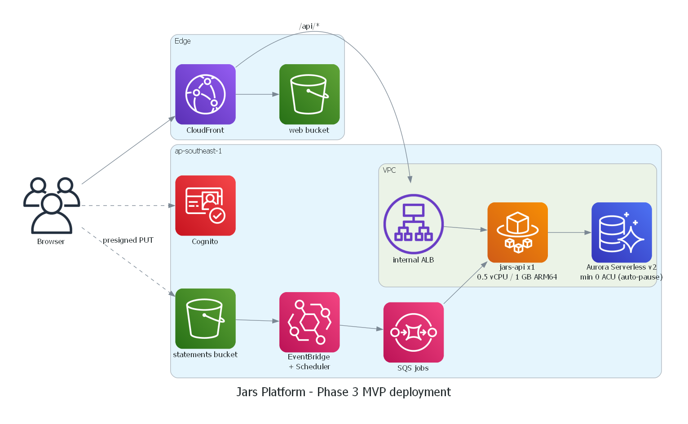

# Jars Platform

[](https://github.com/thphuc06/jar-platform/actions/workflows/ci.yml)

Personal finance built around the **6-jars method**: income is split into jars, expenses are taken from a jar, unusual spending is detected per jar and pushed to the user live. A Java 21 / Spring Boot 4.1 **modular monolith** on AWS, written to show how money-handling backends are built: concurrency-safe ledger, idempotent APIs, transactional outbox, secure-by-default, infrastructure as code, and tests that prove each claim.

> 🇻🇳 Bản tiếng Việt: [README.vi.md](README.vi.md) · Tài liệu thiết kế chi tiết (tiếng Việt): [docs/](docs/README.md)

This is a personal portfolio project, rewritten from scratch from a hackathon prototype. The screens come from that prototype's Lovable-generated UI; everything else (backend, infrastructure, tests, the data/auth/realtime layer of the web client) is written here.



*The diagram is the MVP topology; the statements bucket and its EventBridge rule belong to the CSV-import feature, which is not built yet. Everything else in the picture is deployed by `infra/cdk`.*

## What it does

- **Jars and ledger.** Six default jars (necessities, financial freedom, long-term savings, education, play, give) plus custom ones. Income, expenses and jar-to-jar transfers go through an **append-only ledger**; a jar's balance is always the sum of its entries.
- **Spending alerts.** Each expense is checked against that jar's history with two complementary detectors (a robust outlier test for single large expenses, CUSUM for sustained drift). Alerts become notifications and arrive over **Server-Sent Events** within a second.
- **Dashboard.** One request returns balance, income, expense, spending by jar and category, and a six-month trend, served from a read model that is kept up to date by events.
- **Money Inbox.** Keyset-paginated transaction list with filters; expenses can be re-categorised or moved to another jar with a reversing ledger entry.

## Engineering highlights

Every row links to the code and to the test that proves it.

| Concern | How it is handled | Proof |
|---|---|---|
| **No lost updates** | Optimistic locking (`@Version`) on the jar row; the retry loop sits *outside* the transaction, because a transaction that lost a version race is rollback-only | `LedgerPostingTest`: 12 writers race on one jar, every accepted expense is in the balance, every rejected one is not, and `balance == SUM(entries)` holds |
| **Deadlock found and fixed** | Transfers A→B and B→A updated two rows in opposite order and PostgreSQL reported `deadlock detected`. Fixed with `hibernate.order_updates` (rows are always written in primary-key order) and by treating a deadlock victim as a retryable conflict | `concurrentTransfersBetweenTwoJars_keepBothLedgersConsistent` |
| **Idempotent POSTs** | `Idempotency-Key` row is inserted *in the business transaction*, so concurrent duplicates queue on the unique index and the second one replays the first response | `IdempotencyServiceTest` and `LedgerPostingTest`: 8 threads, one posting |
| **Money is exact** | `BigDecimal` / `NUMERIC(19,2)`, amounts serialised as strings, an ArchUnit rule forbids `double`/`float` in domain code | `MoneyTest`, `MoneyArchitectureTest`, [ADR-0014](docs/04-adr/0014-money-and-ledger-model.md) |
| **Modular monolith** | Spring Modulith modules (`identity`, `ledger`, `insights`, `notification`); module boundaries and cycles are verified on every build | `ModularityTests` (it also tests itself with a deliberately violating fixture), [ADR-0003](docs/04-adr/0003-modular-monolith-spring-modulith.md) |
| **Reliable events** | In-process events go through the Modulith outbox (`event_publication`), consumers are idempotent (`processed_messages`), listeners run after commit | `InsightsFlowTest` (a redelivered event is counted once), `InsightsModuleTest` (Modulith `Scenario`) |
| **Authorization** | Stateless OAuth2 resource server for Cognito; only *access* tokens from our own app clients are accepted (fails closed); every query is scoped to the caller and someone else's resource is a `404`, not a `403` | `AccessTokenValidatorsTest`, the IDOR matrix in `LedgerReadAndSecurityTest` |
| **Realtime** | SSE with a 15 s heartbeat, replay of missed notifications from `Last-Event-ID` (UUIDv7 ids sort by time), push only after the transaction commits | `NotificationStreamTest`, over a real HTTP connection |
| **Errors** | RFC 9457 `problem+json` everywhere, including 401/403 produced before MVC, with a `traceId` that is also in the logs | `PlatformWebLayerTest` |
| **Environment parity** | The production profile is started by a test (a bug that only showed under the `aws` profile was found by running the Docker image, then pinned by a test) | `AwsProfileTest` |
| **Infrastructure as code** | AWS CDK in Java: six stacks, guardrail tests (no NAT gateway, ARM64 tasks, no `0.0.0.0/0` ingress, log retention) and `cdk-nag` | `infra/cdk` (95 tests), [ADR-0012](docs/04-adr/0012-iac-aws-cdk-java.md) |
| **Cost engineering** | Aurora Serverless v2 scales to zero and auto-pauses, no NAT gateway, Graviton, teardown-by-default; the app is configured so nothing keeps a database connection open | [ADR-0008](docs/04-adr/0008-database-aurora-serverless-v2.md), [ADR-0013](docs/04-adr/0013-networking-no-nat.md), [cost doc](docs/05-operations/cost-and-budget.md) |

**Backend: 188 tests, 95% line coverage** (96% on domain and service code, which the build enforces at 80%), Spotless formatting and a secret scan (gitleaks) on every pull request.

Decisions are recorded as 22 [ADRs](docs/04-adr/README.md), including the ones where the design had to change because reality disagreed (Java 21 instead of 25, no IAM Identity Center, a CloudFront Function instead of error pages for the SPA fallback).

## Tech stack

| Layer | Technology |
|---|---|
| Backend | Java 21, Spring Boot 4.1, Spring Modulith 2.1, Spring Security (OAuth2 resource server), Spring Data JPA / Hibernate 7, Flyway, springdoc-openapi, Spring Cloud AWS (SQS) |
| Data | PostgreSQL 17 (Amazon Aurora Serverless v2 in AWS) |
| Auth | Amazon Cognito (managed login, Authorization Code + PKCE) |
| Compute / edge | ECS Fargate (ARM64), internal ALB, CloudFront with a VPC origin, S3 |
| Infrastructure | AWS CDK v2 (Java), GitHub Actions |
| Testing | JUnit 5, AssertJ, Testcontainers, Awaitility, ArchUnit, Modulith `Scenario`, Spring Security Test |
| Web | React, Vite, TypeScript, Tailwind / shadcn-ui |

## Run it locally

Needs JDK 21 and Docker. No AWS account and no Cognito are needed: the `local` profile mints its own tokens.

```bash
cd apps/jars-api
./mvnw spring-boot:run "-Dspring-boot.run.arguments=--jars.seed.enabled=true"   # starts Postgres from local/compose.yaml, loads demo data

TOKEN=$(curl -s -X POST localhost:8080/dev/token -H 'Content-Type: application/json' -d '{"sub":"demo"}' | jq -r .accessToken)
curl -s localhost:8080/api/v1/dashboard -H "Authorization: Bearer $TOKEN"
curl -s localhost:8080/api/v1/anomalies -H "Authorization: Bearer $TOKEN"     # two alerts from the seeded unusual purchases
```

Swagger UI is at <http://localhost:8080/swagger-ui.html> (Authorize with the token). Run the whole test suite with `./mvnw clean verify`.

## Deploy

`infra/cdk` creates everything in `ap-southeast-1`; the application image is built for ARM64 and pushed to ECR by `scripts/push-image.ps1`; `scripts/smoke-test.ps1` then checks the deployed system end to end through CloudFront (real Cognito tokens, idempotency, cross-user isolation, an anomaly arriving as a live SSE event). Steps and costs: [deployment](docs/05-operations/deployment.md), [runbook](docs/05-operations/runbook.md).

## Repository layout

```
apps/jars-api/     Spring Boot modular monolith (Maven)
apps/web/          React web client
infra/cdk/         AWS CDK (Java)
contracts/openapi/ OpenAPI file generated from the controllers; a test fails when it drifts
scripts/           push-image and smoke-test
docs/              architecture, API contract, 22 ADRs, operations, roadmap
```

## Status

Phase 1 ("core to cloud") is implemented and the base AWS stacks are deployed from code; what is built, what is deliberately left out (CSV import, AI advisor, stock quotes, splitting a service out, full observability) and why: [docs/06-plan/roadmap.md](docs/06-plan/roadmap.md).
