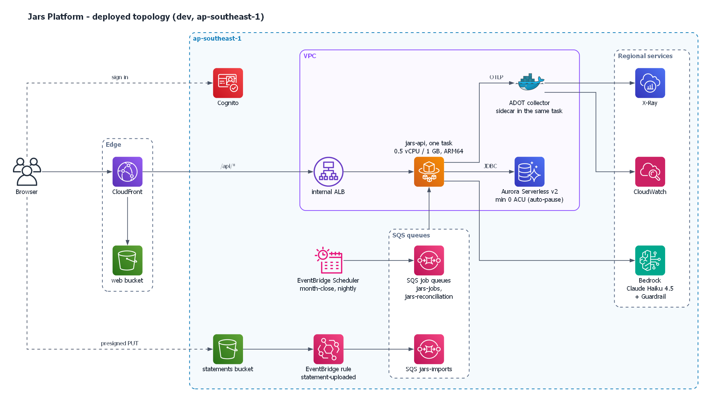

# Jars Platform

> 🇬🇧 English version: [README.md](README.md)

[](https://github.com/thphuc06/jar-platform/actions/workflows/ci.yml)

Ứng dụng quản lý tài chính cá nhân theo **phương pháp 6 chiếc hũ (6 Jars)**: chia thu nhập vào hũ, theo dõi chi tiêu, phát hiện chi tiêu bất thường, lập lộ trình tiết kiệm cho mục tiêu, và có trợ lý AI tư vấn.

Đây là **repo cá nhân**, viết lại **từ đầu** project hackathon *Jars/IUS* (org `swinhackathon`). Mục tiêu là làm một **portfolio Java Backend + AWS** (khi hoàn thành sẽ demo và đưa lên CV được những gì: [cv-showcase.md](docs/01-product/cv-showcase.md)):
- Backend viết bằng **Java 21 + Spring Boot 4.1** ([ADR-0019](docs/04-adr/0019-java-21-lts.md)).
- Hạ tầng **AWS-native**: ECS Fargate, Aurora Serverless v2, Cognito, SQS, EventBridge, Bedrock; tất cả dựng bằng **AWS CDK (Java)**.
- Không có Python ở runtime: phần cổ phiếu (vnstock, PyPortfolioOpt) của bản hackathon đã bỏ vì giấy phép của nguồn dữ liệu ([ADR-0024](docs/04-adr/0024-drop-market-and-quant-fn.md)).

> **Trạng thái (2026-11-13):** ✅ Backend lõi chạy được và đã deploy thử lên AWS bằng CDK (Cognito, VPC không NAT, Aurora Serverless v2 scale-to-zero, ECS Fargate ARM64, CloudFront). Có thêm ngân sách, khép sổ tháng, mục tiêu và web client React. Phase 2 thêm import sao kê CSV (Spring Batch, S3 → EventBridge → SQS), trợ lý AI trên Bedrock có guardrail, và OpenTelemetry → X-Ray/CloudWatch. 826 test backend, coverage dòng 95,8%; smoke test trên AWS 14/14; k6 qua CloudFront p95 đọc 117 ms, p95 ghi 200 ms. Có thêm **audit log** (bảng `audit_log` append-only, ghi bằng `@Audited` trong cùng transaction với nghiệp vụ, [ADR-0025](docs/04-adr/0025-audit-log-aop-same-transaction.md)) và **job đối soát sổ cái hằng đêm** (`balance == SUM(entries)`, chỉ phát hiện và báo; đã viết và test, chưa deploy lên AWS). Phần cổ phiếu (market, `quant-fn`) đã bỏ ([ADR-0024](docs/04-adr/0024-drop-market-and-quant-fn.md)). Chi tiết tiến độ và những gì chưa làm: [docs/06-plan/roadmap.md](docs/06-plan/roadmap.md).



*Topology đang được deploy (CloudFront, ALB internal, một task Fargate kèm sidecar ADOT, Aurora Serverless v2, S3 → EventBridge → SQS cho sao kê, Bedrock); tất cả do `infra/cdk` tạo. Bản chi tiết hơn của hệ thống hiện tại: [`aws-architecture.png`](docs/diagrams/aws-architecture.png).*

## Tech stack (tóm tắt)

| Lớp | Công nghệ |
|---|---|
| Backend | Java 21 LTS, Spring Boot 4.1, Spring Modulith 2.1, Spring Security (OAuth2 Resource Server), Spring Data JPA, Flyway, Spring Batch, Spring AI 2.0, Spring Cloud AWS 4.2 |
| Database | Amazon Aurora PostgreSQL Serverless v2 (scale-to-zero) |
| Messaging | Transactional outbox in-process (Spring Modulith); SQS + DLQ, EventBridge (S3 events) và EventBridge Scheduler. SNS FIFO → SQS FIFO là backlog Phase 3+ |
| AI | Amazon Bedrock (Claude Haiku, cross-region inference profile) + Bedrock Guardrails |
| Frontend | React + Vite + shadcn/ui (PWA), host trên S3 + CloudFront |
| Auth | Amazon Cognito User Pool (managed login, Authorization Code + PKCE) |
| Compute | Amazon ECS on AWS Fargate (ARM64 / Graviton) |
| IaC / CI-CD | AWS CDK v2 (Java), GitHub Actions + OIDC |
| Observability | Micrometer + OpenTelemetry (sidecar ADOT) → CloudWatch / X-Ray; load test bằng k6 |

Chi tiết và lý do của từng lựa chọn nằm ở [docs/02-architecture/overview.md](docs/02-architecture/overview.md) và các [ADR](docs/04-adr/README.md).

## Cấu trúc repo

```
jar-platform/
├── apps/
│   ├── jars-api/          # Java 21 · Spring Boot 4.1 · modular monolith (Maven)
│   └── web/               # React + Vite PWA (chuyển từ ius_financial_ui)
├── infra/
│   └── cdk/               # AWS CDK v2 viết bằng Java: toàn bộ hạ tầng
├── contracts/
│   ├── openapi/           # OpenAPI spec do jars-api sinh ra (commit vào repo)
│   └── events/            # (chưa có) JSON Schema cho domain events, dự kiến khi externalize event
├── local/                 # docker compose cho môi trường dev local (hiện chỉ có Postgres)
├── scripts/               # push-image, smoke-test, load-test
├── docs/                  # toàn bộ tài liệu (bắt đầu từ docs/README.md)
└── .github/workflows/     # ci, web, infra (mỗi PR, có path filter) và deploy-dev (chạy tay)
```

## Đọc tài liệu theo thứ tự nào?

1. [docs/README.md](docs/README.md): bản đồ tài liệu và quy tắc cập nhật.
2. [Vision & scope](docs/01-product/vision-and-scope.md): sản phẩm làm gì, không làm gì.
3. [Architecture overview](docs/02-architecture/overview.md), rồi [AWS infrastructure](docs/02-architecture/aws-infrastructure.md).
4. [Roadmap](docs/06-plan/roadmap.md): đang ở phase nào, bước tiếp theo là gì.

## Quick start

Yêu cầu: JDK 21, Docker đang chạy. Chi tiết: [docs/05-operations/local-development.md](docs/05-operations/local-development.md).

```bash
cd apps/jars-api
./mvnw verify            # build + test (Testcontainers Postgres 17) + Modulith verify + Spotless check
./mvnw spring-boot:run   # tự khởi động local/compose.yaml (Postgres) → http://localhost:8080
curl localhost:8080/api/v1/health
```
