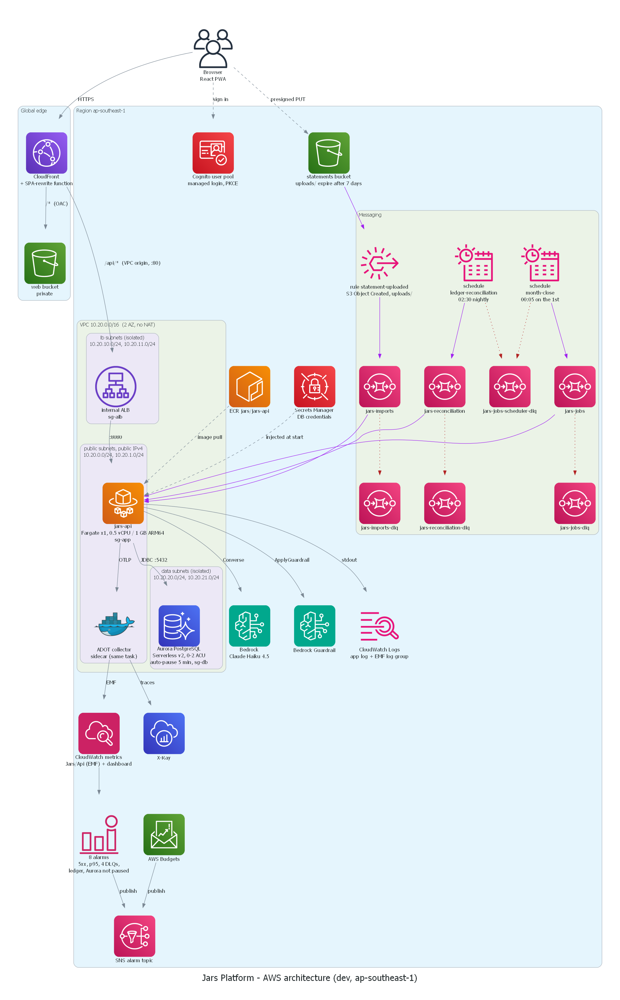
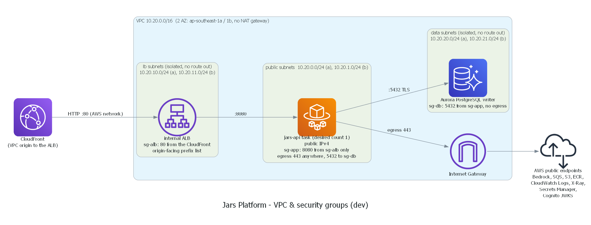

# AWS Infrastructure

> Region: **ap-southeast-1 (Singapore)** ([ADR-0005](../04-adr/0005-region-ap-southeast-1.md)) · Môi trường: **`dev`** (duy nhất) · IaC: **AWS CDK v2 (Java)** ([ADR-0012](../04-adr/0012-iac-aws-cdk-java.md))
> Giá trích dẫn ở đây lấy từ AWS Pricing API cho ap-southeast-1 ngày **2026-10-23**. Chi tiết xem [cost-and-budget.md](../05-operations/cost-and-budget.md).



## 1. CDK stacks

Hạ tầng chia thành nhiều stack theo **vòng đời**: stack nào hay bị xóa và tạo lại (App) thì không chứa dữ liệu, còn stack chứa dữ liệu (Data) thì giữ lâu dài.

| Stack | Chứa gì | Vòng đời | Phụ thuộc |
|---|---|---|---|
| `JarsFoundation` | ECR repository `jars/jars-api` (immutable tags, scan on push), GitHub OIDC provider + deploy role, SNS topic cho alarm, AWS Budget theo tag `Project=jars` | Tạo 1 lần, giữ mãi | – |
| *(không phải stack)* account baseline | Cost Anomaly Detection (có sẵn). S3 Block Public Access (account), EBS default encryption, IAM Access Analyzer: **không bật** (quyết định P0.2). Không thuộc stack nào vì áp dụng cho cả account dùng chung ([deployment.md §1](../05-operations/deployment.md#1-chuẩn-bị-tài-khoản-làm-1-lần)) | Giữ mãi | – |
| `JarsNetwork` | VPC 2 AZ (public / private / isolated subnets), security groups | Giữ mãi (không tốn phí giờ) | – |
| `JarsData` | Aurora PostgreSQL Serverless v2 + secret (hoặc RDS với `-c dbMode=rds`). S3 `jars-dev-statements-<account>` (Phase 2 WP3: tên cố định để `JarsMessaging` và `JarsApp` không cần export; `RETAIN`; `uploads/` hết hạn sau 7 ngày; bật EventBridge; CORS `PUT` cho `https://*.cloudfront.net` và `http://localhost:5173`) | Giữ mãi (`RemovalPolicy.SNAPSHOT`) | Network |
| `JarsAuth` | Cognito User Pool, managed login domain, resource server/scopes, app client `smoke` cho script smoke test | Giữ mãi (user không mất) | – |
| `JarsMessaging` | SQS (jobs, imports) + DLQ, EventBridge rules, Scheduler; Phase 3+ (backlog): SNS FIFO + SQS FIFO. **Hiện có:** `jars-jobs` + DLQ, schedule `month-close`, `jars-imports` + DLQ, rule `statement-uploaded`, alarm cho 3 DLQ. **Trong code, chưa deploy:** `jars-reconciliation` + DLQ + alarm, schedule `ledger-reconciliation` | Giữ mãi (gần như $0) | Foundation (alarm topic). Tên bucket statements suy ra từ env + account, không phụ thuộc stack Data |
| `JarsApp` | ECS cluster, task definition, service, internal ALB, CloudFront + VPC origin, web bucket, Cognito app client, alarm Aurora không pause, guardrail Bedrock, sidecar ADOT + dashboard + alarm ([§11](#11-observability)). Không có Valkey ([§10](#10-cache-elasticache-serverless-valkey-chưa-có)). Chỉ được synth khi có context `imageTag` | **Xóa khi không demo lâu ngày** | Foundation, Network, Data, Auth, Messaging |
| ~~`JarsObservability`~~ | Gộp vào `JarsApp` (construct `ApiObservability`, Phase 2 WP2): collector ADOT, dashboard `jars-dev`, alarm 5xx và p95. Xem [§11](#11-observability) | Theo `JarsApp` | – |

**Thứ tự deploy lần đầu:** Foundation → Network → Auth → Data → Messaging → App. CDK tự suy ra thứ tự khi chạy `cdk deploy --all`.

> **Vì sao Cognito *app client* nằm ở `JarsApp` chứ không ở `JarsAuth`?** Callback URL của app client phải là domain CloudFront, mà CloudFront nằm trong `JarsApp`. Đặt app client ở `JarsAuth` sẽ tạo phụ thuộc vòng. User pool (chứa user) vẫn nằm ở `JarsAuth` nên xóa `JarsApp` không làm mất user.

**Tag chung** cho mọi resource: `Project=jars`, `Env=dev`, `ManagedBy=cdk`, `Owner=thphuc06`. Hãy bật `Project` làm *cost allocation tag* để lọc chi phí trong Cost Explorer.

## 2. Edge: CloudFront + S3 + VPC origin

| Hạng mục | Cấu hình |
|---|---|
| Distribution | Một distribution, domain mặc định `dxxxx.cloudfront.net` (domain riêng chưa hỗ trợ: CDK không có Route 53/ACM) |
| Behavior `/*` (default) | Origin = S3 `web` bucket qua **Origin Access Control (OAC)**; cache policy `CachingOptimized`; SPA fallback bằng **CloudFront Function** `viewer-request` (đường dẫn không có đuôi file → `/index.html`). Không dùng custom error response 403/404 vì nó áp dụng cả cho `/api/*` ([ADR-0020](../04-adr/0020-spa-fallback-cloudfront-function.md)) |
| Behavior `/api/*` | Origin = **VPC origin** trỏ tới **internal ALB**; cache policy `CachingDisabled`; origin request policy `AllViewerExceptHostHeader`; allowed methods = ALL. CloudFront **mặc định bỏ header `Authorization`** và không cho thêm header này riêng lẻ vào origin request policy. Chỉ khi chuyển *toàn bộ* viewer header (và tắt cache) thì `Authorization` mới tới origin ([re:Post](https://repost.aws/knowledge-center/cloudfront-authorization-header), [managed policies](https://docs.aws.amazon.com/AmazonCloudFront/latest/DeveloperGuide/using-managed-origin-request-policies.html)) |
| Timeout | Origin response timeout mặc định 30 s. SSE gửi **heartbeat mỗi 15 s** nên kết nối không bị coi là idle. Keep-alive timeout chỉnh được với custom/VPC origin |
| Response headers policy | HSTS, `X-Content-Type-Options`, `X-Frame-Options`, `Referrer-Policy`, CSP `frame-ancestors 'none'` (CSP đầy đủ cho SPA thêm khi có UI). Áp dụng cho cả hai behavior |
| WAF | Tùy chọn, backlog Phase 3+ (tốn phí theo web ACL + rule) |

**Vì sao dùng VPC origin:** CloudFront kết nối thẳng vào ALB nằm trong private subnet thông qua một ENI do AWS quản lý. ALB **không có IP public**, nên không ai bỏ qua CloudFront để gọi thẳng API được. Yêu cầu khi cấu hình:
- Security group của ALB phải cho phép CloudFront managed prefix list.
- Subnet phải còn IPv4 trống cho ENI.
- VPC phải có Internet Gateway (IGW chỉ đánh dấu VPC nhận traffic internet, không dùng để route).
- Prefix list `origin-facing` tính khoảng 55 rule vào hạn mức security group (mặc định 60 rule), nên `sg-alb` chỉ còn chỗ cho vài rule khác.
- VPC origin tạo mất tới khoảng 15 phút; origin protocol là HTTP cổng 80.

Docs: [Restrict access with VPC origins](https://docs.aws.amazon.com/AmazonCloudFront/latest/DeveloperGuide/private-content-vpc-origins.html).

## 3. Network: VPC



| Subnet group (×2 AZ) | CDK `SubnetType` | CIDR | Chứa | Route ra internet |
|---|---|---|---|---|
| `public` | `PUBLIC` | 10.20.0.0/24, 10.20.1.0/24 | ECS tasks (`assignPublicIp=ENABLED`) | IGW |
| `lb` ("private") | `PRIVATE_ISOLATED` | 10.20.10.0/24, 10.20.11.0/24 | internal ALB, ENI của CloudFront VPC origin | Không |
| `data` ("isolated") | `PRIVATE_ISOLATED` | 10.20.20.0/24, 10.20.21.0/24 | Aurora | Không |

> Trong CDK, `PRIVATE_WITH_EGRESS` bắt buộc phải có NAT, nên cả hai nhóm không có NAT đều khai báo là `PRIVATE_ISOLATED`. Tách làm hai nhóm `lb` và `data` để quy tắc security group rõ ràng hơn (không có NACL tùy chỉnh, dùng NACL mặc định của VPC).

**Không có NAT Gateway** ([ADR-0013](../04-adr/0013-networking-no-nat.md)). Task cần gọi ra ngoài (Bedrock, SQS, ECR, Cognito JWKS...) thì đi qua IP public của chính nó. An toàn được đảm bảo bằng security group:

| Security group | Inbound | Outbound |
|---|---|---|
| `sg-alb` | TCP 80 từ CloudFront managed prefix list (origin-facing) | TCP 8080 tới `sg-app` |
| `sg-app` | TCP 8080 **chỉ từ `sg-alb`** | 443 ra mọi nơi; 5432 tới `sg-db` |
| `sg-db` | TCP 5432 từ `sg-app` (và `sg-worker` nếu tách `insights-worker`, Phase 3+ backlog) | – |

> Lộ trình nâng cấp lên "chuẩn production": chuyển task vào private subnet và thêm NAT Gateway (khoảng $43/tháng mỗi AZ) **hoặc** VPC interface endpoint ($0.013/giờ mỗi endpoint mỗi AZ) **hoặc** dùng fck-nat trên EC2 t4g.nano (khoảng $3.9/tháng). Chi tiết trong ADR-0013.

## 4. Compute: ECS on Fargate

| Hạng mục | `jars-api` | `insights-worker` (Phase 3+, backlog) |
|---|---|---|
| Launch type | Fargate, **ARM64 (Graviton)** | Fargate ARM64 |
| CPU / RAM | 0.5 vCPU / 1 GB cho cả task: container app 896 MiB (JVM `-XX:MaxRAMPercentage=75`), sidecar ADOT 128 MiB ([§11](#11-observability)) | 0.25 vCPU / 0.5 GB |
| Desired count | 1 (dev). Đặt về 0 khi "ngủ" | 1 / 0 |
| Image | ECR `jars/jars-api:<git-sha>`, base `eclipse-temurin:21-jre` (multi-arch) | `jars/insights-worker:<sha>` |
| Port | 8080 (ALB target group, health check `/actuator/health/readiness`) | không mở port |
| Deployment | Rolling + **deployment circuit breaker (auto rollback)**; Phase 3+ (backlog) thử **ECS native blue/green** | Rolling |
| Logs | `awslogs` driver → CloudWatch Logs, log JSON, retention 14 ngày | như bên trái |
| Secrets | `secrets:` trong task definition lấy từ Secrets Manager (DB credentials) | như bên trái |
| Config | Biến môi trường (không phải secret): `SPRING_PROFILES_ACTIVE=aws`, `SPRING_DATASOURCE_URL`, `JARS_ISSUER_URI`, `JARS_ALLOWED_CLIENT_IDS`, `JARS_JOBS_QUEUE`, `JARS_RECONCILIATION_QUEUE`, `JARS_IMPORTS_BUCKET`, `JARS_IMPORTS_QUEUE`, `JARS_GUARDRAIL_ID`, `JARS_GUARDRAIL_VERSION`, `JAVA_TOOL_OPTIONS=-XX:MaxRAMPercentage=75`. Model id không truyền qua env: cố định trong `application-aws.yaml` | |

**Task role (quyền của ứng dụng)** và **execution role (quyền của agent ECS để kéo image, đọc secret, ghi log)** là 2 role khác nhau, xem [security.md](security.md#3-iam).

### Vòng đời task: khởi động, dừng, draining

| Thiết lập | Giá trị | Vì sao |
|---|---|---|
| `healthCheckGracePeriod` (service) | 90 s | JVM + Spring Boot + Flyway cần thời gian khởi động. Không có grace period thì ECS có thể giết task trước khi task kịp healthy |
| Health check của target group | `/actuator/health/readiness`, interval 15 s, healthy threshold 2 | Readiness phản ánh "sẵn sàng nhận traffic", liveness phản ánh "process còn sống". Không check DB |
| `server.shutdown=graceful` + `spring.lifecycle.timeout-per-shutdown-phase=20s` | | Khi nhận SIGTERM: ngừng nhận request mới, xử lý xong request đang chạy, dừng SQS listener |
| `stopTimeout` (container) | 30 s (lớn hơn 20 s của Spring) | Hết thời gian này ECS gửi SIGKILL |
| `initProcessEnabled` | `true` | Có init process chuyển tiếp tín hiệu và dọn process con |
| Deregistration delay (target group) | **30 s** (mặc định là 300 s) | Rút ngắn thời gian deploy. Response thường < 1 s. Kết nối SSE dài sẽ bị ALB cắt khi hết draining → client **tự reconnect với `Last-Event-ID`** (đã thiết kế ở [api-contract §3](../03-api/api-contract.md#3-hợp-đồng-sse)) |
| `readonlyRootFilesystem` | `true` + volume tạm mount vào `/tmp` | Giảm bề mặt tấn công; Tomcat cần `/tmp` để ghi |
| User trong container | non-root (UID cố định), đặt trong Dockerfile (CDK không ghi đè `user`) | Best practice bảo mật container |

Docs: [ECS connection draining](https://docs.aws.amazon.com/AmazonECS/latest/developerguide/load-balancer-connection-draining.html), [ECS graceful shutdown (re:Post)](https://repost.aws/knowledge-center/ecs-graceful-shutdown-connection-draining-deployments).

**Health check không được chạm DB.** Nếu health check gọi DB, Aurora sẽ không bao giờ pause. Vì vậy readiness/liveness **không gồm `db`**; trạng thái DB xem ở `/actuator/health` (endpoint đầy đủ, không dùng cho ALB).

Docs: [ECS blue/green deployments](https://docs.aws.amazon.com/AmazonECS/latest/developerguide/migrate-codedeploy-to-ecs-bluegreen.html).

## 5. Database: Aurora PostgreSQL Serverless v2

| Hạng mục | Cấu hình |
|---|---|
| Engine | Aurora PostgreSQL **17.11** (bản 17.x mới nhất ở ap-southeast-1 theo `describe-db-engine-versions` ngày 2026-11-12; scale-to-zero yêu cầu ≥ 16.3) |
| Capacity | **min 0 ACU, max 2 ACU**; auto-pause sau **300 s** không có kết nối (`SecondsUntilAutoPause`) |
| Topology | 1 writer instance (Serverless v2), không có reader |
| Credentials | `credentials: fromGeneratedSecret` (user `jarsadmin`) → Secrets Manager, tên secret do CDK sinh (không đặt tên cố định để tạo lại stack không vướng thời gian chờ xóa; xem output `DbSecretArn`); app đọc qua ECS secrets |
| TLS | Tham số `rds.force_ssl=1` |
| Backup | Automated backup 1 ngày (tối thiểu); xóa stack thì tạo snapshot |
| Kết nối từ app | HikariCP `minimum-idle=0`, `idle-timeout=60s`, `max-lifetime=5m`, `spring.datasource.connection-fetch=lazy` (tính năng mới của Boot 4.1) → **không giữ kết nối khi không có request** |
| Schema | `jars` (jars-api), `insights` (insights-worker, Phase 3+ backlog). App hiện dùng master user `jarsadmin` (`DataStack`); DB user riêng cho từng service là kế hoạch khi tách worker (backlog Phase 3+) |

**Bẫy cần nhớ:**
- Còn **bất kỳ kết nối nào** mở (pool, health check, scheduled job, tool GUI quên đóng) thì Aurora **không pause**, và 0.5 ACU × 24 h × 30 ngày × $0.20 = **$72/tháng**. Có alarm `ServerlessDatabaseCapacity > 0` liên tục 6 giờ để cảnh báo.
- Resume mất khoảng vài giây đến khoảng 15 s. Request đầu tiên sau khi pause sẽ chậm. Timeout kết nối của Hikari cần ≥ 30 s.
- Autovacuum không đánh thức DB đang pause.

**Phương án dự phòng:** RDS PostgreSQL `db.t4g.micro` ($0.025/giờ ≈ $18/tháng, cố định). Chỉ cần đổi một CDK context flag `-c dbMode=rds`. Xem [ADR-0008](../04-adr/0008-database-aurora-serverless-v2.md).

Docs: [Aurora Serverless v2 auto-pause](https://docs.aws.amazon.com/AmazonRDS/latest/AuroraUserGuide/aurora-serverless-v2-auto-pause.html).

## 6. Auth: Cognito

| Hạng mục | Cấu hình |
|---|---|
| User pool | Feature plan **Essentials**. Đăng nhập bằng email, tự đăng ký + xác minh email (sender mặc định của Cognito); password policy mặc định (8 ký tự, đủ 4 loại); **MFA tắt** ở dev |
| Managed login | Domain `jars-dev-thphuc06.auth.ap-southeast-1.amazoncognito.com` (managed login v2; mỗi app client cần một resource branding) |
| App client (SPA) | **Public client, không có client secret**; flow **Authorization Code + PKCE**; scope `openid email profile`; callback `https://<cloudfront-domain>/auth/callback` và `http://localhost:5173/auth/callback`; logout `https://<cloudfront-domain>/` và `http://localhost:5173/`. Nằm trong `JarsApp` |
| App client `smoke` | Public, không secret, chỉ `ADMIN_USER_PASSWORD_AUTH` + refresh token, không OAuth. Dành cho script smoke test (script tạo user tạm bằng quyền IAM của người chạy). Nằm trong `JarsAuth` |
| Token | Access token 60 phút, refresh token 30 ngày; API **chỉ nhận access token** (`token_use=access`) |
| Resource server | Identifier `jars-api`, scope `jars-api/read`, `jars-api/write` |
| Lambda trigger | Không có. User nội bộ được tạo lười (lazy) ở request đầu tiên (xem [flows.md](flows.md#f1)) |

Docs: [Cognito pricing](https://aws.amazon.com/cognito/pricing/). Tier Lite/Essentials có free tier hằng tháng không hết hạn.

## 7. Messaging

| Resource | Loại | Producer → Consumer | Cấu hình chính | Phase |
|---|---|---|---|---|
| `jars-jobs` | SQS standard + DLQ | EventBridge Scheduler → jars-api | visibility 5 phút, `maxReceiveCount=5` | 1 ✅ |
| `jars-jobs-scheduler-dlq` | SQS standard | EventBridge Scheduler (gửi lỗi) | retention 14 ngày; alarm khi có message | 1 ✅ |
| `jars-imports` | SQS standard + DLQ (`jars-imports-dlq`, alarm khi có message) | S3 → EventBridge rule → jars-api | visibility 15 phút, `maxReceiveCount=3` | 2 ✅ |
| `jars-ledger-events.fifo` | **SNS FIFO** | jars-api (outbox) → subscribers | content-based dedup, message group = `userId` | 3+ (backlog) |
| `jars-insights-ledger.fifo` | SQS FIFO + DLQ | SNS ledger → insights-worker | raw message delivery | 3+ (backlog) |
| `jars-insights-events.fifo` | SNS FIFO | insights-worker → subscribers | | 3+ (backlog) |
| `jars-api-notifications.fifo` | SQS FIFO + DLQ | SNS insights → jars-api | | 3+ (backlog) |
| Rule `statement-uploaded` | EventBridge (default bus) | S3 `Object Created` (bucket statements, prefix `uploads/`) → `jars-imports` | bucket bật `eventBridgeEnabled`; queue policy chỉ cho rule này gửi. Đã kiểm thật ngày 2026-11-13: upload thử → message tới queue | 2 ✅ |
| Schedule `month-close` | EventBridge Scheduler | → `jars-jobs` | `cron(5 0 1 * ? *)`, timezone **Asia/Ho_Chi_Minh**, flexible window off | 1 ✅ |
| `jars-reconciliation` | SQS standard + DLQ (`jars-reconciliation-dlq`, alarm khi có message) | EventBridge Scheduler → jars-api | retention **1 giờ** (message cũ vô giá trị, `JarsApp` bị destroy thì message tự hết hạn), visibility 5 phút, `maxReceiveCount=3` | 3 (code xong, **chưa deploy**) |
| Schedule `ledger-reconciliation` | EventBridge Scheduler | → `jars-reconciliation` | `cron(30 2 * * ? *)`, timezone **Asia/Ho_Chi_Minh**; đối soát `balance == SUM(entries)` mỗi đêm, chỉ phát hiện và báo (metric `jars.ledger.reconciliation.mismatches`, alarm trong `JarsApp`), đánh thức Aurora một lần mỗi ngày | 3 (code xong, **chưa deploy**) |

Chi tiết schema và đảm bảo giao nhận: [event-catalog.md](event-catalog.md). Lý do không dùng Kafka/MSK: [ADR-0009](../04-adr/0009-messaging-sns-sqs-eventbridge.md).

## 8. AI: Bedrock

| Hạng mục | Cấu hình |
|---|---|
| Model chat | `global.anthropic.claude-haiku-4-5-20251001-v1:0` (mặc định; Haiku 5.5 bị AccessDenied ở account này, theo P0.5); `global.anthropic.claude-sonnet-4-6` (tùy chọn, cho lộ trình phức tạp) |
| Loại endpoint | **Global cross-region inference profile**: request có thể được xử lý ở region khác. Chấp nhận được cho dev; nếu có yêu cầu lưu trữ dữ liệu trong nước thì đây là điểm cần xem lại |
| API | `ConverseStream` qua Spring AI `spring-ai-starter-model-bedrock-converse` |
| Guardrails | Guardrail `jars-dev-advisor` tạo bằng CDK trong `JarsApp` (Phase 2 WP4): denied topic "khuyến nghị mua/bán chứng khoán cụ thể", PII (số thẻ, CCCD 12 số; **không** lọc số tài khoản vì sẽ che luôn số tiền), content filter, prompt attack filter `HIGH` (chỉ đầu vào). Spring AI 2.0 không gắn được guardrail vào Converse nên app gọi `ApplyGuardrail` trước model và sau khi stream xong ([ADR-0023](../04-adr/0023-advisor-guardrail-and-rate-limit.md)). Kết quả kiểm trên AWS (WP6, 13/11): chặn đúng "nên mua cổ phiếu FPT không?" (tiếng Việt và tiếng Anh) trong khoảng 0,4 giây, trước khi gọi model; chặn prompt attack bằng tiếng Anh; **không** chặn prompt attack bằng tiếng Việt (tier Classic chủ yếu hỗ trợ tiếng Anh, muốn chặn thì cân nhắc tier Standard); mã hũ (`NEC`, `FFA`, ...) bị coi là mã cổ phiếu nên `BedrockGuardrail` đổi chúng thành tên hũ trước khi gửi đi |
| RAG (tùy chọn; backlog Phase 3+, chưa có code) | Bedrock Knowledge Base + **S3 Vectors** (GA 12/2025, có ở Singapore) với `cohere.embed-multilingual-v3`, nguồn là các file `kb/*.md` về sản phẩm ngân hàng |
| Quyền IAM | Policy `ApiAdvisorPolicy` theo mẫu 3 phần của AWS cho global cross-region inference: `InvokeModel` và `InvokeModelWithResponseStream` trên inference profile ở `ap-southeast-1`, foundation model ở `ap-southeast-1` và foundation model không region (`aws:RequestedRegion = unspecified`). Statement của inference profile chỉ có điều kiện `aws:RequestedRegion`; hai statement foundation model có thêm điều kiện `bedrock:InferenceProfileArn`; `bedrock:ApplyGuardrail` trên đúng guardrail |
| Kiểm soát chi phí | Rate limit theo user trong PostgreSQL (20 tin/giờ, 60 tin/ngày), `max-tokens` 800, metric `jars.advisor.messages`, `jars.advisor.tokens`, `jars.advisor.ungrounded`. Đo thật ngày 2026-11-13 (Haiku 4.5, dữ liệu demo): một lượt có gọi tool tốn khoảng 3.600–3.900 token vào, 150–250 token ra; byte đầu tiên sau 1,3–2,1 giây |

## 9. ~~Quant: Lambda `quant-fn`~~ (đã bỏ)

Lambda Python lấy giá cổ phiếu bằng vnstock và tối ưu danh mục bằng PyPortfolioOpt đã bị bỏ khỏi thiết kế vì giấy phép của vnstock không cho dùng trong sản phẩm cho bên thứ ba ([ADR-0024](../04-adr/0024-drop-market-and-quant-fn.md)).

## 10. ~~Cache: ElastiCache Serverless (Valkey)~~ (chưa có)

Thiết kế ban đầu có Valkey cho cache dashboard, rate limit chat và pub/sub fan-out thông báo. Không resource nào như vậy được dựng (kiểm trong `infra/cdk`): rate limit của advisor nằm trong PostgreSQL ([ADR-0023](../04-adr/0023-advisor-guardrail-and-rate-limit.md)) và hiện chỉ có một task API nên SSE không cần fan-out. Chỉ đáng thêm khi chạy từ 2 task `jars-api` trở lên (khoảng $6/tháng, tối thiểu 100 MB được tính phí, theo nguồn bên thứ ba, cần kiểm tra lại); khi đó nó nằm trong `JarsApp`. Backlog Phase 3+.

## 11. Observability

**Đang có (Phase 2 WP2).** Toàn bộ nằm trong `JarsApp` (construct `ApiObservability`), không tách stack `JarsObservability` như thiết kế ban đầu: alarm và dashboard theo dõi ALB và service của chính `JarsApp`, nên tách stack chỉ thêm export và một lượt deploy/destroy cho cùng vòng đời.

```
jars-api ──OTLP/HTTP localhost:4318──► ADOT collector (sidecar, v0.51.0)
                                         ├─ traces ─────────────► X-Ray
                                         └─ metrics jars.* ─EMF─► CloudWatch Jars/Api (log group /jars/dev/api/metrics)
ALB, ECS, RDS, SQS ── metric mặc định (miễn phí) ──► dashboard jars-dev + alarm
```

| Tín hiệu | Cấu hình |
|---|---|
| Logs | stdout JSON (ECS format, profile `aws`) → `/jars/dev/api`, retention 14 ngày. Mọi dòng có `traceId` qua MDC; `traceId` trong body lỗi RFC 9457 và header `traceparent` của response **là trace id của X-Ray** (`TraceIdFilter` lấy từ span hiện tại). Log **không** gửi qua OTLP để khỏi trả tiền hai lần |
| Traces | `spring-boot-starter-opentelemetry` (Micrometer Tracing + OTel bridge), sampling 100% (lưu lượng dev nhỏ; X-Ray miễn phí 100.000 trace đầu mỗi tháng). Span cho request HTTP (bỏ `/actuator/**` và các span của Spring Security), JDBC qua Spring Data, listener SQS (`spring.cloud.aws.sqs.observation-enabled`), lần khép sổ tháng (`jars.month.close`). X-Ray exporter từ bản contrib 0.86.0 nhận trace id dạng W3C, nên không cần bộ sinh id của X-Ray |
| Metrics nghiệp vụ | `jars.transactions.posted` (tag `type`, `source`), `jars.anomalies.detected` (tag `detector`, `severity`), timer `jars.month.close` (tag `trigger`); advisor: `jars.advisor.messages` (tag `outcome`), `jars.advisor.tokens` (tag `direction`), `jars.advisor.ungrounded`; đối soát (code xong, chưa deploy): gauge `jars.ledger.reconciliation.mismatches` và `jars.ledger.reconciliation.jars.checked` (kết quả của lần chạy gần nhất, gauge chứ không phải counter vì exporter EMF bỏ điểm đầu của counter tích lũy) và counter `jars.ledger.reconciliation.runs` (tag `result`). Đếm **sau khi transaction commit** (`AfterCommit`), nên lần thử bị rollback vì optimistic lock không bị đếm. Tag chỉ có vài giá trị; không bao giờ gắn user id hay jar id |
| Metrics hệ thống | Lấy từ metric mặc định của ALB (request, 5xx, `TargetResponseTime` p50/p95/p99), ECS (CPU, memory), RDS (ACU), SQS (độ sâu queue). Collector **lọc bỏ** metric JVM và HTTP của Micrometer (processor `filter/business`): cấu hình ECS mặc định của ADOT đẩy tất cả, tức vài trăm custom metric. Container Insights vẫn tắt |
| Alarm | `jars-dev-api-5xx-rate`: tỷ lệ 5xx > 5% trong 2 chu kỳ 5 phút liên tiếp, chỉ tính khi có ≥ 20 request/chu kỳ; `jars-dev-api-p95-latency`: p95 > 1 s trong 15 phút (bỏ qua một chu kỳ chậm khi Aurora vừa resume); `jars-dev-aurora-not-paused`: Aurora không pause 6 giờ (`JarsApp`); `jars-dev-ledger-reconciliation-mismatches` (`JarsApp`, trong code, chưa deploy): metric `jars.ledger.reconciliation.mismatches` > 0 (Maximum trong 5 phút, thiếu dữ liệu coi là bình thường); DLQ có message (`JarsMessaging`): `jars-jobs-dlq`, `jars-jobs-scheduler-dlq`, `jars-imports-dlq`, và `jars-reconciliation-dlq` (trong code, chưa deploy). Tất cả gửi về SNS `jars-dev-alarms` |
| Dashboard | `jars-dev`: request và 5xx, thời gian phản hồi p50/p95/p99, CPU và memory của ECS, ACU của Aurora, sự kiện nghiệp vụ (`SEARCH` theo namespace `Jars/Api`), độ sâu queue jobs và DLQ |
| Bộ nhớ trong task | Task 1 GB chia cứng: app 896 MiB (JVM `MaxRAMPercentage=75` tính heap từ con số này), collector 128 MiB, non-essential (collector chết thì API vẫn chạy) |
| Load test | `scripts/load-test.ps1`: tạo user Cognito tạm, chạy `scripts/load-test.js` bằng `grafana/k6:2.3.0` trong Docker qua CloudFront, ngưỡng p95 đọc < 300 ms, ghi < 500 ms |

Chưa làm (Phase 3+): `traceparent` trong message attributes khi **app gửi** message (hiện app chỉ nhận message từ EventBridge Scheduler, vốn không gửi trace context), alarm `jars-jobs` tồn quá 1 giờ.

## 12. Dịch vụ dùng chung

| Dịch vụ | Dùng làm gì | Ghi chú |
|---|---|---|
| ECR | `jars/jars-api`, `jars/insights-worker` (Phase 3+) | Lifecycle: giữ 10 image gần nhất; bật basic scan on push; **tag immutable** (git SHA không bị ghi đè) |
| S3 (`statements`, `web`) | Upload sao kê, static web | Block Public Access; bucket policy `enforceSSL`; SSE-S3; `statements/uploads/` **tự xóa sau 7 ngày** (lifecycle) |
| Cost Anomaly Detection | Phát hiện chi phí tăng bất thường | Không tính phí; email alert hằng ngày |
| IAM Access Analyzer | Phát hiện resource bị chia sẻ public hoặc cross-account | Không bật (quyết định P0.2). External access analyzer miễn phí nếu sau này muốn bật (unused access analyzer **có phí**) |
| Secrets Manager | DB credentials (CDK sinh ra) | $0.40/secret/tháng. Config không nhạy cảm thì để biến môi trường. Chưa bật rotation tự động vì không có NAT ([runbook](../05-operations/runbook.md#đổi-secret-db)) |
| AWS Budgets | Budget riêng cho project, lọc theo tag `Project=jars` | Cảnh báo ở 50/80/100% |
| CloudTrail | Event history 90 ngày (mặc định, miễn phí) | Không tạo trail riêng ở dev |
| IAM user `phuc-account` + `aws login` | Thiết kế đích cho truy cập của người (console + CLI), thay cho root; bắt buộc MFA; không có access key dài hạn. ADR-0018 đang hoãn: CLI hiện vẫn đăng nhập bằng root ([security.md §3](security.md#3-iam)) | Không dùng Identity Center: [ADR-0018](../04-adr/0018-human-access-iam-user-aws-login.md) |

## 13. Quy ước đặt tên

- Resource: `jars-<env>-<component>`, ví dụ `jars-dev-api-alb`, `jars-dev-db`.
- SQS/SNS FIFO phải có hậu tố `.fifo`.
- SSM / Secrets: `/jars/dev/<component>/<name>`.
- CloudWatch Logs: `/jars/dev/<service>`.
