# Data Model

> Schema được quản lý bằng **Flyway** (`apps/jars-api/src/main/resources/db/migration/V<n>__<mô_tả>.sql`). Tài liệu này mô tả **thiết kế đích**, còn migration là nguồn sự thật. Sau mỗi migration phải cập nhật lại tài liệu này.
> Thiết kế mới **không** dùng lại `schema.sql` của bản hackathon. Lý do và các điểm thay đổi xem mục 5.

**Migration đã có** (schema PostgreSQL `jars`, do Flyway tạo; app kết nối với `hikari.schema=jars`):

| Version | File | Nội dung | Bước |
|---|---|---|---|
| V1 | `V1__baseline_users.sql` | Bảng `users`: `id` UUID (app sinh), `cognito_sub` UNIQUE, `email` UNIQUE **không phân biệt hoa/thường** (unique index trên `lower(email)`), `locale` mặc định `vi-VN`, `created_at`/`updated_at` | P0.6 |
| V2 | `V2__idempotency_keys.sql` | Bảng `idempotency_keys` (PK `user_id` + `key`), chủ sở hữu là `platform` | WP1 |
| V3 | `V3__identity.sql` | Bỏ unique index email và cho phép `email` NULL (danh tính chỉ dựa trên `cognito_sub`; access token Cognito không có claim email); thêm `risk_assessments` (một dòng mỗi lần nộp bảng hỏi, dòng mới nhất là hồ sơ hiện tại) | WP2 |
| V4 | `V4__ledger.sql` | `jars` (có `version`, `balance` cache, index unique `(user_id, code)` cho 6 hũ mặc định), `categories` (+ 19 danh mục hệ thống, id cố định), `transactions` (có `to_jar_id` cho chuyển hũ và các CHECK ràng buộc loại giao dịch), `jar_entries` (chỉ ghi thêm). `currency` là `VARCHAR(3)` thay vì `CHAR(3)` để Hibernate `validate` khớp kiểu. `jar_entries.created_at` là thời điểm **phát sinh** của giao dịch (để vẽ số dư theo ngày), còn `balance_after` là số dư chạy theo **thứ tự ghi sổ** | WP3 |
| V5 | `V5__modulith_event_publication.sql` | `event_publication` (+ `_archive`): outbox của Spring Modulith (cột theo bản 2.1; chế độ hoàn tất `delete`, listener xong thì xóa dòng) | WP4 |
| V6 | `V6__insights_notifications.sql` | `processed_messages` (inbox), `anomaly_detector_state`, `anomalies`, `monthly_jar_spend`, `monthly_category_spend`, `monthly_cashflow`, `notifications`. Không có khóa ngoại sang bảng của ledger (module chỉ tham chiếu nhau bằng id) | WP4 |
| V7 | `V7__budgeting.sql` | `jar_periods` (mỗi hũ mỗi tháng một dòng, `UNIQUE (jar_id, period_month)`, `period_month` là ngày đầu tháng giờ VN, `planned_amount`, `spent_amount`, `closed_at`) và `allocation_decisions` (`UNIQUE (user_id, idempotency_key)`, `decision` ACCEPTED / EDITED / SKIPPED, `suggested`/`applied` JSONB). Không có khóa ngoại sang bảng của ledger hay `users` (giống V6) | WP5 |
| V8 | `V8__goals.sql` | `goals` (`target_amount > 0`, `status` ACTIVE / ACHIEVED / ARCHIVED, `funding_jar_id` chỉ tham chiếu bằng id, `version`, `archived_at`; index `(user_id, status, created_at, id)`). Không có khóa ngoại sang `users` hay ledger | WP5 |
| V9 | `V9__imports.sql` | `statement_imports` (`status` AWAITING_UPLOAD / PROCESSING / COMPLETED / FAILED, `file_sha256` để chặn nhập cùng tệp hai lần), `statement_import_errors` (PK `(import_id, line_number)`) và các bảng metadata `BATCH_*` của Spring Batch 6.0 (chép nguyên từ `spring-batch-core`). Không có khóa ngoại sang ledger | Phase 2 WP3 |
| V10 | `V10__advisor.sql` | `chat_sessions`, `chat_messages` (FK `session_id` → `chat_sessions`, `ON DELETE CASCADE`; `role` USER / ASSISTANT; cột `guardrail`) và `advisor_usage` (bộ đếm cửa sổ cố định HOUR / DAY cho rate limit, [ADR-0023](../04-adr/0023-advisor-guardrail-and-rate-limit.md)) | Phase 2 WP4 |
| V11 | `V11__audit_log.sql` | `audit_log` (append-only: trigger từ chối `UPDATE`, `DELETE`, `TRUNCATE`; index `(actor, occurred_at DESC, id DESC)`), chủ sở hữu là `platform` ([ADR-0025](../04-adr/0025-audit-log-aop-same-transaction.md)) | F14 |
| V12 | `V12__product_catalog.sql` | `catalog_products`: 18 sản phẩm của danh mục **hư cấu** Ngân hàng TMCP Lục Bình, dữ liệu tham chiếu giống nhau cho mọi user (cột có kiểu cho phần danh sách gọn và các quy tắc: nhóm, mức rủi ro 1 đến 5 và loại rủi ro, hồ sơ phù hợp, mức tối thiểu, thu nhập tối thiểu; văn bản dài và số liệu ở cột text hoặc JSONB; `as_of` và `illustrative`), chủ sở hữu là `advisor` ([ADR-0027](../04-adr/0027-advisor-product-catalog-and-profile.md)) | Advisor sản phẩm |
| V13 | `V13__profile_facts.sql` | `users.age_band` và `users.income_situation` (nullable, CHECK theo mã): hai câu hỏi onboarding mới, không thuộc điểm rủi ro. User cũ để NULL = "chưa trả lời" | Advisor sản phẩm |

## 1. Quy ước

| Chủ đề | Quy ước | Lý do |
|---|---|---|
| Khóa chính | `UUID` sinh ở app theo **UUIDv7** (có thứ tự theo thời gian) | Không lộ số lượng bản ghi, index B-tree không bị phân mảnh như UUIDv4 |
| Tiền | `NUMERIC(19,2)` + cột `currency CHAR(3)`; trong Java dùng `BigDecimal` bọc trong record `Money` | Không bao giờ dùng `double` hay `float`. VND không có đơn vị lẻ nhưng vẫn để scale 2 để sau này mở rộng đa tiền tệ ([ADR-0014](../04-adr/0014-money-and-ledger-model.md)) |
| Dấu của số tiền | `transactions.amount` luôn **> 0**, hướng dòng tiền thể hiện qua cột `type`. `jar_entries.amount` **có dấu** (+ vào hũ, − ra khỏi hũ) | Dữ liệu người dùng nhập thì dễ hiểu, còn sổ cái thì dễ cộng dồn |
| Thời gian | `TIMESTAMPTZ`, lưu UTC; trong Java dùng `Instant` | Quy đổi sang giờ `Asia/Ho_Chi_Minh` chỉ khi tính "tháng" hoặc khi hiển thị |
| Tháng ngân sách | `DATE` = ngày đầu tháng theo giờ VN (ví dụ `2026-11-01`); trong Java dùng `YearMonth` | Tránh lệch tháng do múi giờ |
| Enum | `TEXT` + `CHECK` constraint; trong Java dùng `enum` + `@Enumerated(STRING)` | Dễ migrate hơn kiểu enum của PostgreSQL |
| Concurrency | Bảng có cập nhật đồng thời có cột `version BIGINT` (`@Version`) | Optimistic locking |
| Audit cột | `created_at`, `updated_at` (`@CreatedDate` / `@LastModifiedDate`) | |
| Xóa | Xóa mềm (`archived_at`) với `jars` và `goals`; **giao dịch không bao giờ xóa**, muốn sửa thì ghi bút toán điều chỉnh | Giữ toàn vẹn lịch sử tài chính |
| Phân quyền dữ liệu | Mọi bảng nghiệp vụ có `user_id`; mọi query đều lọc theo `user_id` | Chống IDOR |

## 2. ERD

```mermaid
erDiagram
    users ||--o{ risk_assessments : has
    users ||--o{ jars : owns
    users ||--o{ categories : defines
    users ||--o{ transactions : records
    users ||--o{ goals : sets
    users ||--o{ notifications : receives
    users ||--o{ chat_sessions : opens
    users ||--o{ statement_imports : uploads
    jars ||--o{ jar_entries : "ledger of"
    jars ||--o{ jar_periods : "budget per month (by id, no FK)"
    users ||--o{ allocation_decisions : decides
    transactions ||--o{ jar_entries : "produces 1..2"
    categories ||--o{ transactions : classifies
    categories ||--o{ categories : parent
    jars ||--o| anomaly_detector_state : "CUSUM state"
    jars ||--o{ anomalies : flags
    transactions ||--o{ anomalies : "may trigger"
    chat_sessions ||--o{ chat_messages : contains

    users {
        uuid id PK
        text cognito_sub UK "JWT sub"
        text email "nullable, không unique (V3)"
        text display_name
        text locale "vi-VN"
        text age_band "nullable: UNDER_25|AGE_25_34|AGE_35_44|AGE_45_54|AGE_55_PLUS (V13)"
        text income_situation "nullable: REGULAR_SALARY|IRREGULAR_INCOME|NO_INCOME_YET (V13)"
        timestamptz created_at
    }
    risk_assessments {
        uuid id PK
        uuid user_id FK
        jsonb answers
        int score
        text risk_level "CONSERVATIVE|BALANCED|GROWTH"
        timestamptz assessed_at
    }
    jars {
        uuid id PK
        uuid user_id FK
        text code "NEC|FFA|LTSS|EDU|PLAY|GIVE|CUSTOM"
        text name
        numeric target_pct "0..100"
        numeric balance "cached = SUM(jar_entries)"
        char currency
        bigint version "optimistic lock"
        timestamptz archived_at
    }
    jar_entries {
        uuid id PK
        uuid jar_id FK
        uuid transaction_id FK "nullable"
        text entry_type "ALLOCATE|SPEND|TRANSFER_IN|TRANSFER_OUT|ADJUST"
        numeric amount "signed"
        numeric balance_after
        timestamptz created_at
    }
    jar_periods {
        uuid id PK
        uuid jar_id "UNIQUE cùng period_month, không FK"
        uuid user_id
        date period_month "ngày đầu tháng, giờ VN"
        numeric planned_amount "đã phân bổ vào hũ trong tháng"
        numeric spent_amount "đã chi, cộng dồn từ event"
        timestamptz closed_at "đặt một lần khi khép sổ"
        timestamptz created_at
    }
    allocation_decisions {
        uuid id PK
        uuid user_id
        text idempotency_key "UNIQUE cùng user_id"
        text request_hash
        text decision "ACCEPTED|EDITED|SKIPPED"
        numeric amount ">0"
        date period_month
        uuid transaction_id "null khi SKIPPED"
        jsonb suggested "[{jarId, amount}] gợi ý"
        jsonb applied "[{jarId, amount}] đã áp dụng"
        timestamptz created_at
    }
    categories {
        uuid id PK
        uuid user_id FK "null = system default"
        uuid parent_id FK
        text name
        text kind "EXPENSE|INCOME"
    }
    transactions {
        uuid id PK
        uuid user_id FK
        text type "INCOME|EXPENSE|JAR_TRANSFER"
        numeric amount ">0"
        char currency
        uuid jar_id FK "nullable for INCOME; nguồn của JAR_TRANSFER"
        uuid to_jar_id FK "chỉ cho JAR_TRANSFER"
        uuid category_id FK
        text counterparty
        text note
        timestamptz occurred_at
        text source "MANUAL|IMPORT"
        timestamptz created_at
    }
    goals {
        uuid id PK
        uuid user_id FK
        text name
        numeric target_amount
        date target_date
        uuid funding_jar_id FK
        text status "ACTIVE|ACHIEVED|ARCHIVED"
    }
    anomaly_detector_state {
        uuid jar_id PK
        uuid user_id
        int sample_count
        double mean "Welford: trung bình chạy"
        double m2 "Welford: tổng bình phương độ lệch"
        double cusum_pos
        double cusum_neg
        jsonb recent_amounts "cửa sổ cho kiểm định MAD"
        bigint version
    }
    anomalies {
        uuid id PK
        uuid user_id FK
        uuid jar_id FK
        uuid transaction_id FK
        text detector "CUSUM|MAD"
        text direction "UP|DOWN"
        text severity "LOW|MEDIUM|HIGH"
        numeric score
        numeric threshold
        numeric amount
        timestamptz feedback_at
        text status "OPEN|CONFIRMED|EXPECTED|FALSE_POSITIVE"
        timestamptz detected_at
    }
    notifications {
        uuid id PK
        uuid user_id FK
        text type
        text severity "LOW|MEDIUM|HIGH"
        text title
        text body
        text ref_type
        uuid ref_id
        timestamptz read_at
    }
    chat_sessions {
        uuid id PK "UUIDv7"
        uuid user_id
        text title
        timestamptz updated_at
    }
    chat_messages {
        uuid id PK "UUIDv7"
        uuid session_id FK
        text role "USER|ASSISTANT"
        text content "đã qua guardrail: PII được che, ADR-0026"
        int input_tokens
        int output_tokens
        text guardrail "INPUT|OUTPUT khi guardrail can thiệp"
    }
    statement_imports {
        uuid id PK "UUIDv7, cũng là tên tệp trên S3"
        uuid user_id
        text file_name
        text object_key "uploads/{userId}/{id}.csv"
        text status "AWAITING_UPLOAD|PROCESSING|COMPLETED|FAILED"
        text file_sha256 "một user không nhập cùng tệp hai lần"
        int total_rows
        int posted_rows
        int skipped_rows
        text failure_reason
    }
```

## 3. Bảng kỹ thuật (không có trong ERD)

| Bảng | Module | Mục đích |
|---|---|---|
| `idempotency_keys` (`user_id`, `key`) PK, `request_hash`, `status_code`, `response_body JSONB`, `expires_at` | platform (dùng chung cho ledger, budgeting) | Header `Idempotency-Key` cho các POST làm thay đổi tiền ([api-contract.md](../03-api/api-contract.md#4-idempotency)). Thuộc `platform` vì nhiều module nghiệp vụ cùng dùng, và `platform` không được phụ thuộc module nghiệp vụ |
| `processed_messages` (`consumer`, `message_id`) PK, `processed_at` | platform | **Inbox**: bỏ qua message SQS trùng (at-least-once) |
| `event_publication` (+ `_archive`) | Spring Modulith tự quản lý | **Outbox**: event được ghi cùng transaction nghiệp vụ |
| `monthly_jar_spend` (`user_id`, `jar_id`, `month`) PK, `spent`, `txn_count`; `monthly_category_spend` (`category_id` = UUID toàn số 0 cho khoản chi chưa phân loại); `monthly_cashflow` (`income`, `expense`) | insights | **Read model** cho dashboard (CQRS-lite), cập nhật từ event bằng upsert cộng dồn (delta), nên chuyển một khoản chi sang hũ/danh mục khác chỉ là delta âm và dương |
| `allocation_decisions` (`user_id`, `idempotency_key`) UNIQUE | budgeting | Lưu user chấp nhận (`ACCEPTED`), sửa (`EDITED`) hay bỏ qua (`SKIPPED`) gợi ý phân bổ, kèm gợi ý và phần đã áp dụng (JSONB) để cải thiện gợi ý sau này. Unique theo khóa idempotency nên gửi lại cùng request không ghi dòng thứ hai và không cộng `planned_amount` hai lần |
| `jar_periods` (`jar_id`, `period_month`) UNIQUE | budgeting | Kế hoạch và thực chi của hũ theo tháng. `planned_amount` cộng khi áp dụng một lần phân bổ; `spent_amount` cộng dồn (delta) từ `TransactionPosted` / `TransactionRecategorized`, nên chi tiêu chuyển sang hũ khác chỉ là delta âm và dương. Job khép sổ đặt `closed_at` (không bao giờ dời) và tạo dòng tháng sau |
| `advisor_usage` (`user_id`, `window_kind`, `window_start`) PK, `count` | advisor | Rate limit trợ lý AI theo cửa sổ cố định giờ/ngày ([ADR-0023](../04-adr/0023-advisor-guardrail-and-rate-limit.md)); cửa sổ cũ của user bị xóa ở tin nhắn kế tiếp (V10) |
| `catalog_products` (`code` PK, `sort_order`, `name`, `product_group`, `category`, `risk_kind`, `risk_level`, `risk_level_max`, `suitable_profiles JSONB`, `profile_note`, `min_amount_vnd`, `min_amount_unit`, `min_monthly_income_vnd`, `headline`, `tenor`, `liquidity`, `summary`, `description`, `figures JSONB`, `rate_table JSONB`, `eligibility`, `suits`, `not_suits`, `cautions JSONB`, `as_of`, `illustrative`) | advisor | Danh mục sản phẩm **hư cấu** (V12, [ADR-0027](../04-adr/0027-advisor-product-catalog-and-profile.md)): 18 dòng, chỉ đọc với ứng dụng, giống nhau cho mọi user, nên không có `user_id`. Hai tool `listProducts` (cột ngắn) và `getProductDetails` (cả dòng) đọc bảng này. Ngân hàng, công ty quỹ, công ty bảo hiểm và mọi số liệu đều là minh họa, tính đến `as_of`. Đổi số liệu = migration mới |
| `audit_log` (`id` UUIDv7 PK, `occurred_at`, `actor`, `action`, `entity_type`, `entity_id`, `trace_id`, `payload JSONB`) | platform | Ai làm gì, lúc nào ([ADR-0025](../04-adr/0025-audit-log-aop-same-transaction.md), V11). Aspect `@Audited` ghi **một dòng** trong cùng transaction với thay đổi nghiệp vụ: rollback hay retry thua cuộc đua thì không còn dòng nào, request `Idempotency-Key` phát lại không thêm dòng. `actor` là user id (UUID dạng text) hoặc `system` cho job không có người gọi; `action` và `entity_type` là tên ổn định (`TRANSACTION_POSTED`, `JAR_TRANSFERRED`, `MONTH_CLOSED`... ); `trace_id` là `traceId` của log; `payload` chỉ có id, số tiền dạng chuỗi, enum, cờ, không bao giờ có ghi chú, tên, email, prompt hay nội dung LLM. **Append-only**: trigger từ chối `UPDATE`, `DELETE`, `TRUNCATE`; không có khóa ngoại |
| `statement_import_errors` (`import_id`, `line_number`) PK, `reason` | imports | Các dòng sao kê bị bỏ qua và lý do (tiếng Việt, cho user xem). Ghi cùng transaction với chunk của nó, nên import chạy lại không ghi trùng (V9) |
| `BATCH_*` | Spring Batch 6.0 (schema chép nguyên từ `spring-batch-core`, tạo bằng Flyway V9) | Metadata của job import: job instance theo `importId`, vị trí đọc trong `BATCH_STEP_EXECUTION_CONTEXT`, nhờ đó import thất bại chạy lại từ chunk cuối đã commit |
| `SPRING_AI_CHAT_MEMORY` (tùy chọn) | advisor | Nếu dùng JDBC chat memory repository của Spring AI |

## 4. Index chính

| Index | Phục vụ |
|---|---|
| `transactions (user_id, occurred_at DESC, id DESC)` | Money Inbox, keyset pagination |
| `transactions (user_id, jar_id, occurred_at)` | Chi tiêu theo hũ trong tháng |
| `jar_entries (jar_id, created_at)` | Đối soát số dư hũ |
| `notifications (user_id, created_at DESC, id DESC)` và `notifications (user_id) WHERE read_at IS NULL` (partial) | Danh sách thông báo (keyset) và đếm thông báo chưa đọc (V6) |
| `anomalies (user_id, status, detected_at DESC)` | Màn hình Alerts |
| `users (cognito_sub)` UNIQUE | Map JWT → user |
| `audit_log (actor, occurred_at DESC, id DESC)` | `GET /audit-log`: dòng của chính người gọi, mới nhất trước, keyset |

## 5. Khác gì so với `schema.sql` của bản hackathon?

| Bản cũ | Bản mới | Vì sao |
|---|---|---|
| `jars.allocated_amount`, `used_amount` bị cập nhật đè, `remaining_amount` là cột tính | `jar_entries` chỉ ghi thêm + `jars.balance` cache + `version` | Cập nhật đè gây **lost update** khi có 2 request đồng thời và không còn lịch sử để đối soát |
| `transactions.jar_id`, `category_id` NOT NULL cho mọi loại | `jar_id` có thể null với INCOME; có thêm `type` | Thu nhập chưa vào hũ nào; chuyển hũ là một loại giao dịch riêng |
| `direction debit/credit` + `affects_jar_balance` | `type` + bút toán `jar_entries` | Bỏ cờ boolean khó hiểu |
| Bảng `tier1_*` riêng cho CUSUM | `anomaly_detector_state`, `anomalies` thuộc module insights | Đặt tên theo nghiệp vụ, không theo "tier" kỹ thuật |
| `*_log` nhiều bảng JSONB cho trace của agent | `audit_log` + trace qua OpenTelemetry | Không lưu payload của LLM vào DB nghiệp vụ |
| Supabase anon key truy cập trực tiếp | Chỉ `jars-api` truy cập DB | Kiểm soát quyền tập trung |
