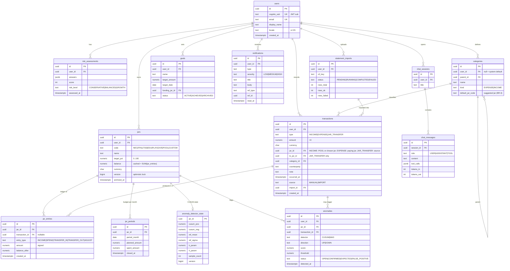

# Data Model

> Schema được quản lý bằng **Flyway** (`apps/jars-api/src/main/resources/db/migration/V<n>__<mô_tả>.sql`). Tài liệu này mô tả **thiết kế đích**, còn migration là nguồn sự thật. Sau mỗi migration phải cập nhật lại tài liệu này.
> Thiết kế mới **không** dùng lại `schema.sql` của bản hackathon. Lý do và các điểm thay đổi xem mục 5.

**Migration đã có** (schema PostgreSQL `jars`, do Flyway tạo; app kết nối với `hikari.schema=jars`):

| Version | File | Nội dung | Bước |
|---|---|---|---|
| V1 | `V1__baseline_users.sql` | Bảng `users`: `id` UUID (app sinh), `cognito_sub` UNIQUE, `email` UNIQUE **không phân biệt hoa/thường** (unique index trên `lower(email)`), `locale` mặc định `vi-VN`, `created_at`/`updated_at` | P0.6 |
| V2 | `V2__event_publication_registry.sql` | Bảng outbox `event_publication` của Spring Modulith, chép từ DDL **v2** chính thức của `spring-modulith-events-jdbc` 2.1.2 (có `status`, `completion_attempts`, `last_resubmission_date`). Khi nâng Modulith: so sánh lại với file `schemas/v2/schema-postgresql.sql` trong jar | P1.4 |
| V5 | `V5__idempotency_keys.sql` | `idempotency_keys`: PK `(user_id, idempotency_key)`, `request_hash` (SHA-256 của endpoint + request đã chuẩn hóa), `response_body JSONB`, `expires_at` (24 h) | P1.6 |
| V4 | `V4__ledger_transactions_and_entries.sql` | `transactions` (amount > 0; `to_jar_id` chỉ có ở `JAR_TRANSFER` và khác `jar_id`; **FK kép `(jar_id, user_id)` → `jars(id, user_id)`**: DB từ chối giao dịch trỏ vào hũ của user khác) và `jar_entries` (dấu của `amount` theo `entry_type`, `balance_after >= 0`, **trigger append-only** chặn UPDATE/DELETE); unique `jars(id, user_id)` | P1.5 |
| V3 | `V3__ledger_jars_and_categories.sql` | `jars` (CHECK: code hợp lệ, `POOL` ⇔ không có `target_pct`, `POOL` không archive, `balance >= 0`; unique `(user_id, code)` trừ `CUSTOM`) và `categories` (`user_id` NULL = hệ thống; EXPENSE không gợi ý `POOL`; tên unique theo `(user_id, kind, lower(name))` **`NULLS NOT DISTINCT`**) + seed 15 danh mục BR-3 với id cố định | P1.4 |

## 1. Quy ước

| Chủ đề | Quy ước | Lý do |
|---|---|---|
| Khóa chính | `UUID` sinh ở app theo **UUIDv7** (có thứ tự theo thời gian) bằng `shared.Ids.newId()`, gán trong factory method của entity. Entity có `@Version Long version` (kiểu **wrapper**): Spring Data coi `version == null` là entity mới và gọi `persist` thay vì `merge`. Entity không có version (`LedgerTransaction`, `JarEntry`) implement `Persistable` (`isNew()` = chưa qua `@PostPersist`/`@PostLoad`) | Không lộ số lượng bản ghi, index B-tree không bị phân mảnh như UUIDv4. Có id ngay trước khi lưu (dùng được trong event). Không dùng `@UuidGenerator` để cả app chỉ có một bộ sinh id |
| Tiền | `NUMERIC(19,2)` + cột `currency CHAR(3)`; trong Java dùng `BigDecimal` bọc trong record `Money` | Không bao giờ dùng `double` hay `float`. VND không có đơn vị lẻ nhưng vẫn để scale 2 để sau này mở rộng đa tiền tệ ([ADR-0014](../04-adr/0014-money-and-ledger-model.md)) |
| Dấu của số tiền | `transactions.amount` luôn **> 0**, hướng dòng tiền thể hiện qua cột `type`. `jar_entries.amount` **có dấu** (+ vào hũ, − ra khỏi hũ) | Dữ liệu người dùng nhập thì dễ hiểu, còn sổ cái thì dễ cộng dồn |
| Thời gian | `TIMESTAMPTZ`, lưu UTC; trong Java dùng `Instant` | Quy đổi sang giờ `Asia/Ho_Chi_Minh` chỉ khi tính "tháng" hoặc khi hiển thị |
| Tháng ngân sách | `DATE` = ngày đầu tháng theo giờ VN (ví dụ `2026-11-01`); trong Java dùng `YearMonth` | Tránh lệch tháng do múi giờ |
| Enum | `TEXT` + `CHECK` constraint; trong Java dùng `enum` + `@Enumerated(STRING)` | Dễ migrate hơn kiểu enum của PostgreSQL |
| Concurrency | Bảng có cập nhật đồng thời có cột `version BIGINT` (`@Version`) | Optimistic locking |
| Audit cột | `created_at`, `updated_at` (`@CreatedDate` / `@LastModifiedDate`) | |
| Xóa | Xóa mềm (`archived_at`) với `jars` và `goals`; **giao dịch không bao giờ xóa**, muốn sửa thì ghi bút toán điều chỉnh | Giữ toàn vẹn lịch sử tài chính |
| Phân quyền dữ liệu | Mọi bảng nghiệp vụ có `user_id`; mọi query đều lọc theo `user_id` | Chống IDOR |

## 2. ERD

## 3. Bảng kỹ thuật (không có trong ERD)

| Bảng | Module | Mục đích |
|---|---|---|
| `idempotency_keys` (`user_id`, `idempotency_key`) PK, `request_hash`, `response_body JSONB`, `expires_at` | ledger (`IdempotencyStore`, chạy **bên trong** transaction nghiệp vụ, không phải filter: filter nằm ngoài transaction nên không commit cùng việc trừ tiền được) | Header `Idempotency-Key` cho các POST làm thay đổi tiền ([api-contract.md](../03-api/api-contract.md#4-idempotency)) |
| `processed_messages` (`consumer`, `message_id`) PK, `processed_at` | platform | **Inbox**: bỏ qua message SQS trùng (at-least-once) |
| `event_publication` | Spring Modulith (bản lưu JDBC), Flyway V2 tạo bảng | **Outbox**: mỗi listener quan tâm có 1 dòng, ghi cùng transaction nghiệp vụ. `completion-mode=delete`: listener thành công thì xóa dòng, lỗi thì giữ (`status=FAILED`) để gửi lại. Không dùng bảng `_archive` |
| `monthly_jar_spend` (`user_id`, `jar_id`, `month`) PK, `spent`, `txn_count` | insights | **Read model** cho dashboard (CQRS-lite), cập nhật từ event |
| `allocation_decisions` | budgeting | Lưu user chấp nhận, sửa hay bỏ qua gợi ý phân bổ, dùng để cải thiện gợi ý |
| `audit_log` | platform | `actor`, `action`, `entity_type`, `entity_id`, `trace_id`, `payload JSONB` |
| `BATCH_*` | Spring Batch tự quản lý | Metadata của job import |
| `SPRING_AI_CHAT_MEMORY` (tùy chọn) | advisor | Nếu dùng JDBC chat memory repository của Spring AI |

## 4. Index chính

| Index | Phục vụ |
|---|---|
| `transactions (user_id, occurred_at DESC, id DESC)` | Money Inbox, keyset pagination |
| `transactions (user_id, jar_id, occurred_at)` | Chi tiêu theo hũ trong tháng |
| `jar_entries (jar_id, created_at)` | Đối soát số dư hũ |
| `notifications (user_id, read_at NULLS FIRST, created_at DESC)` | Danh sách thông báo chưa đọc |
| `anomalies (user_id, status, detected_at DESC)` | Màn hình Alerts |
| `users (cognito_sub)` UNIQUE | Map JWT → user |

## 5. Khác gì so với `schema.sql` của bản hackathon?

| Bản cũ | Bản mới | Vì sao |
|---|---|---|
| `jars.allocated_amount`, `used_amount` bị cập nhật đè, `remaining_amount` là cột tính | `jar_entries` chỉ ghi thêm + `jars.balance` cache + `version` | Cập nhật đè gây **lost update** khi có 2 request đồng thời và không còn lịch sử để đối soát |
| `transactions.jar_id`, `category_id` NOT NULL cho mọi loại | `jar_id` luôn có (INCOME chưa chọn hũ thì là `POOL`), `category_id` tùy chọn; có thêm `type` và `to_jar_id` | Thu nhập chưa vào hũ nào; chuyển hũ là một loại giao dịch riêng |
| `direction debit/credit` + `affects_jar_balance` | `type` + bút toán `jar_entries` | Bỏ cờ boolean khó hiểu |
| Bảng `tier1_*` riêng cho CUSUM | `anomaly_detector_state`, `anomalies` thuộc module insights | Đặt tên theo nghiệp vụ, không theo "tier" kỹ thuật |
| `*_log` nhiều bảng JSONB cho trace của agent | `audit_log` + trace qua OpenTelemetry | Không lưu payload của LLM vào DB nghiệp vụ |
| Supabase anon key truy cập trực tiếp | Chỉ `jars-api` truy cập DB | Kiểm soát quyền tập trung |
