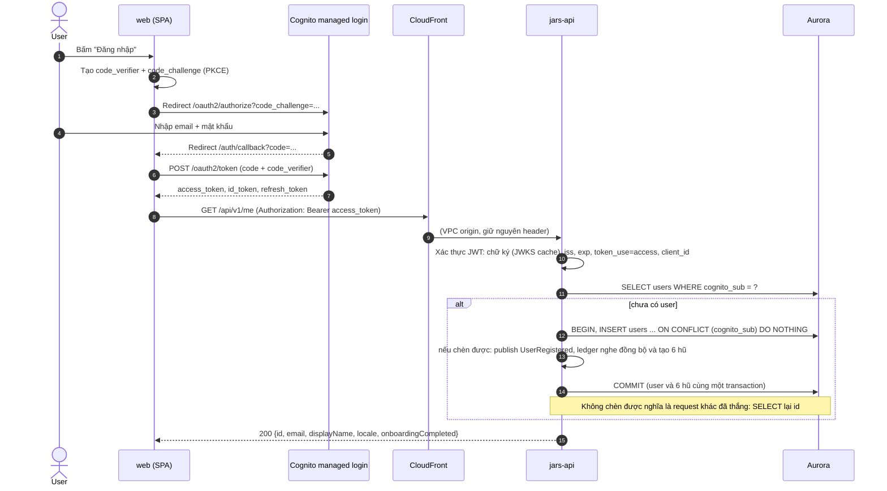
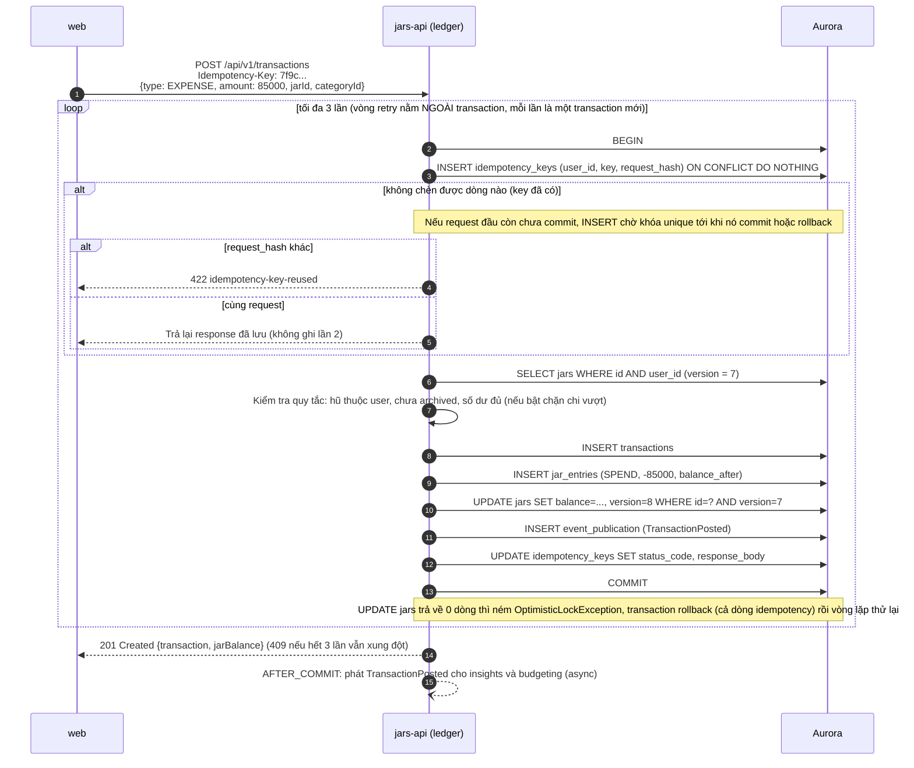
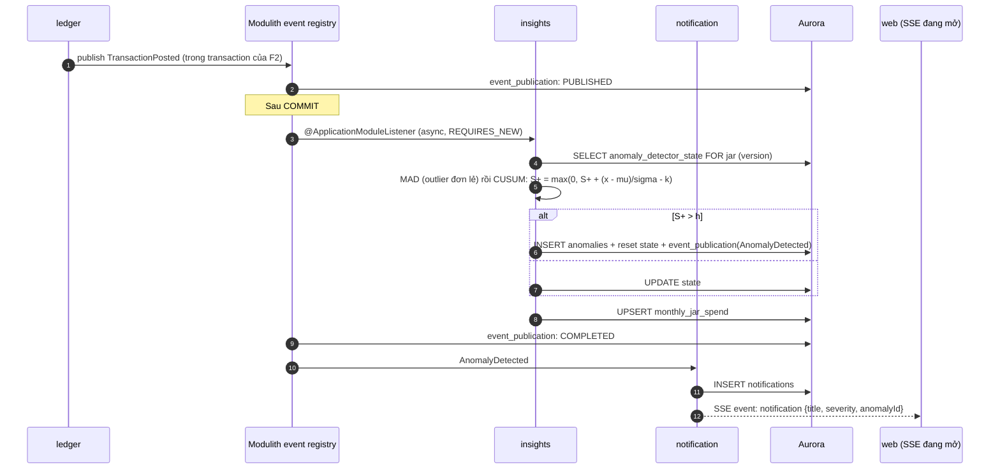
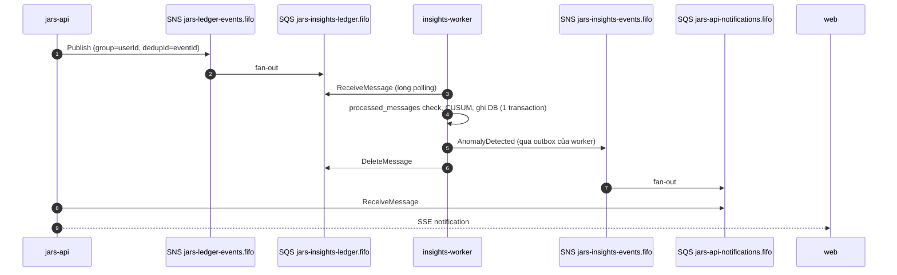
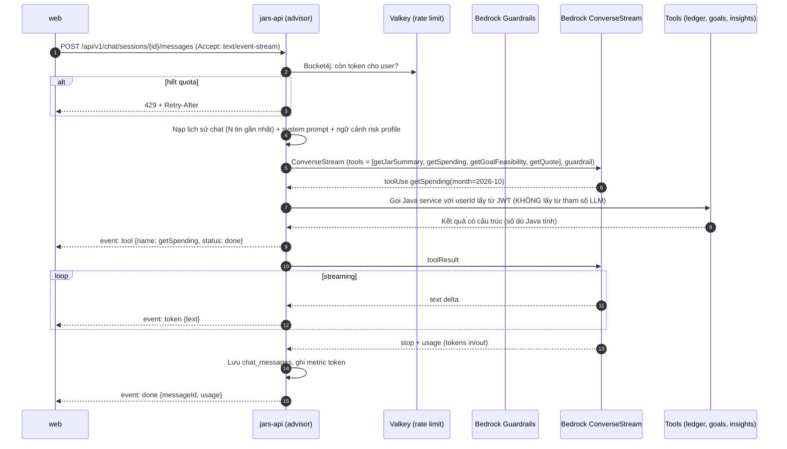
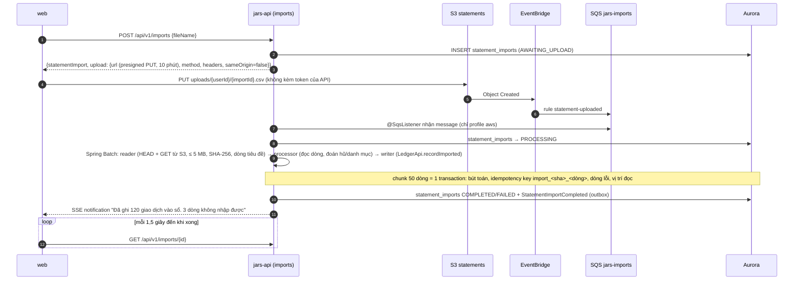
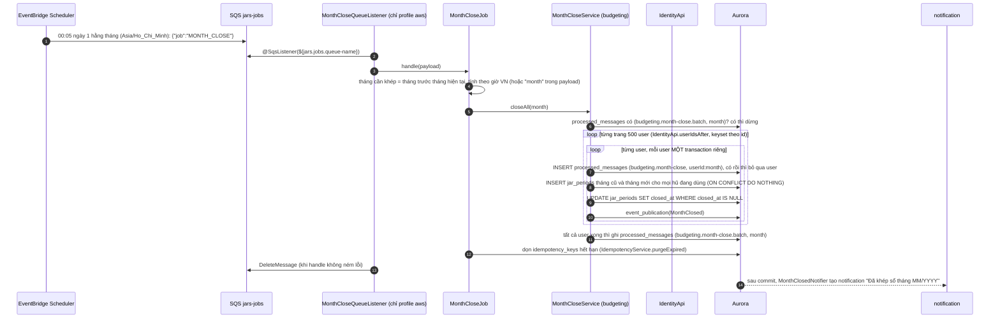
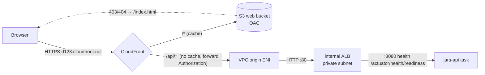
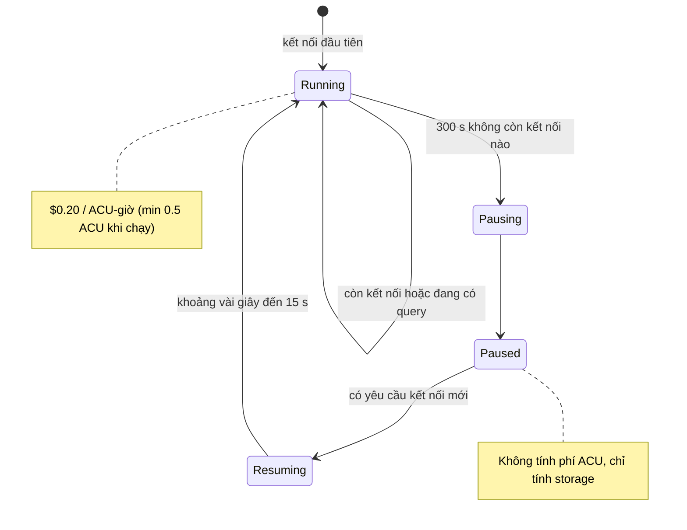

# Luồng chính (Runtime flows)

Mỗi luồng ghi rõ **có từ phase nào** và **điểm kỹ thuật cần học**. Ký hiệu: `CF` = CloudFront, `ALB` = internal ALB, `API` = jars-api.

| ID | Luồng | Phase |
|---|---|---|
| [F1](#f1) | Đăng nhập + request đầu tiên (tạo user lazy) | 1 |
| [F2](#f2) | Ghi một khoản chi (idempotency, optimistic lock, outbox) | 1 |
| [F3](#f3) | Phát hiện bất thường → thông báo realtime (SSE) | 2 (in-process), 5 (qua SNS/SQS) |
| [F4](#f4) | Chat AI streaming với tool calling + guardrails | 4 |
| [F5](#f5) | Import sao kê CSV | 2 (local), 3 (S3 + EventBridge) |
| [F6](#f6) | Khép sổ cuối tháng theo lịch | 3 |
| [F7](#f7) | Định tuyến request ở edge | 3 |
| [F8](#f8) | Aurora auto-pause / resume | 3 |

---

## F1. Đăng nhập + request đầu tiên

**Điểm cần học:**
- **PKCE** thay cho client secret, vì SPA không giữ được bí mật.
- API chỉ nhận **access token**. ID token dùng để hiển thị thông tin user ở frontend, không dùng để gọi API.
- **Race condition:** 2 request đầu tiên đến cùng lúc thì cả hai cùng thấy "chưa có user". Xử lý bằng `INSERT ... ON CONFLICT (cognito_sub) DO NOTHING` rồi SELECT lại (có test 12 luồng đồng thời).
- **Email:** access token của Cognito không có claim `email` nên `users.email` hiện để trống; UI đã có email từ ID token. Khi cần gửi mail sẽ lấy qua endpoint `/oauth2/userInfo`.
- Spring Security xác thực JWT **offline** bằng JWKS được cache, nên không phải gọi Cognito ở mỗi request.

---

## F2. Ghi một khoản chi (Transfer / quick add)

**Điểm cần học:** `@Transactional` (proxy, rollback rules), optimistic locking với `@Version`, isolation `READ COMMITTED` (mặc định của PostgreSQL) và vì sao nó đủ dùng khi đã có `@Version`, idempotency key, outbox.

**Vì sao retry phải nằm ngoài transaction:** transaction đã gặp `OptimisticLockException` bị đánh dấu rollback-only và entity trong persistence context đã cũ. Thử lại trong cùng transaction vẫn dùng dữ liệu cũ. Vòng retry phải gọi một method `@Transactional` từ bên ngoài proxy (bean khác), để mỗi lần có transaction và persistence context mới.

**Thử lại tối đa 5 lần với backoff ngẫu nhiên** (`jars.ledger.max-attempts`, nâng từ 3 sau khi test đồng thời 12 luồng trên một hũ). Vòng retry bắt `ConcurrencyFailureException`, tức cả xung đột `@Version` lẫn nạn nhân của deadlock; hết lượt thì trả 409 `version-conflict`.

**Deadlock khi chuyển hũ hai chiều (đã gặp thật khi viết test):** chuyển A→B và B→A cùng lúc làm hai transaction `UPDATE` hai dòng `jars` theo thứ tự ngược nhau, PostgreSQL báo `deadlock detected` (SQLSTATE 40P01). Cách xử lý: bật `hibernate.order_updates` để mọi transaction ghi các dòng theo thứ tự khóa chính (nguyên nhân gốc), và coi nạn nhân deadlock như xung đột đồng thời (retry, rồi 409). Test `concurrentTransfersBetweenTwoJars_keepBothLedgersConsistent` giữ cho lỗi này không quay lại.

**Chi tiêu vượt số dư:** mặc định vẫn ghi (tiền đã tiêu rồi, số dư âm cho thấy tiêu lố); đặt `jars.ledger.block-overspend=true` để từ chối với 422 `insufficient-jar-balance`. Chuyển hũ luôn cần đủ tiền ở hũ nguồn.

**Vì sao INSERT key nằm trong cùng transaction:** hai request cùng key chạy đồng thời sẽ va vào unique index. Request sau chờ cho tới khi request đầu commit, rồi thấy key đã tồn tại và trả response đã lưu. Nếu request đầu rollback thì dòng key cũng biến mất và request sau được chạy bình thường. Không cần trạng thái `IN_PROGRESS` riêng.

---

## F3. Phát hiện bất thường → thông báo realtime

### Phase 2–4 (in-process)

**Thuật toán đã cài (`SpendingDetector`)**, chạy trên mỗi khoản chi của một hũ:

1. 5 khoản chi đầu tiên chỉ để học baseline (trung bình/độ lệch chuẩn chạy bằng Welford).
2. **MAD:** với trung vị m và MAD d của tối đa 30 khoản gần nhất, điểm z hiệu chỉnh = 0.6745 (x - m) / d; lớn hơn 3.5 là *spike* (HIGH nếu > 7). Spike **không** được đưa vào baseline hay CUSUM để không làm nhiễm chúng.
3. **CUSUM** trên z = (x - mean)/sigma với k = 0.5, h = 5: S+ vượt h là chi tăng kéo dài, S- dưới -h là chi giảm kéo dài (LOW). Sigma có sàn 10% của mean và MAD có sàn 5% của trung vị, để hũ có lịch sử toàn khoản bằng nhau không coi chênh lệch 1 đồng là vô cùng bất thường.
4. Trạng thái của hũ bị khóa bi quan (`SELECT ... FOR UPDATE`) trong lúc xử lý, nên các event của một hũ được áp dụng lần lượt.

Dữ liệu chuẩn của test lấy từ `test_cusum_sliding_window_local.py` của bản hackathon (baseline 100k, sigma 52k: lệch tăng dần báo ở khoản thứ 10, không đổi 200k báo ở khoản thứ 4).

### Phase 5 (externalized, qua SNS/SQS)

**Fan-out SSE khi có nhiều task:** user có thể đang giữ kết nối SSE ở task A trong khi task B nhận message. Cách xử lý (Phase 4+): task nhận message publish lên kênh Valkey `notif:{userId}`, task nào đang giữ kết nối của user đó thì đẩy xuống. Khi chỉ có 1 task thì không cần.

---

## F4. Chat AI streaming

**Điểm cần học:**
- Tool chỉ đọc dữ liệu, và `userId` luôn lấy từ security context, nên prompt injection không đọc được dữ liệu của người khác.
- Guardrail chặn nội dung khuyến nghị mua/bán cổ phiếu cụ thể.
- Streaming bằng `Flux` (Spring AI) chuyển sang `SseEmitter` (MVC), hoặc trả `Flux<ServerSentEvent>` trực tiếp.
- Chi phí được kiểm soát nhờ rate limit + `max-tokens`.

---

## F5. Import sao kê CSV

Ở local và trong test không có S3/SQS: `upload.url` là `PUT /api/v1/imports/{id}/file` cùng origin (`sameOrigin=true`, gửi kèm token), endpoint này ghi tệp ra thư mục tạm và chạy job ngay trong request.

| Tình huống | Kết quả |
|---|---|
| Dòng sai ngày, số tiền bằng 0, ngày ở tương lai, ledger từ chối (`DomainException`) | Dòng bị skip, ghi vào `statement_import_errors`; các dòng khác vẫn nhập |
| Thiếu cột ngày hoặc số tiền, tệp không phải UTF-8, lớn hơn 5 MB, **cùng tệp đã nhập xong trước đó** | Cả tệp bị từ chối: `FAILED` + `failureReason` |
| Xung đột optimistic lock với giao dịch user đang ghi cùng lúc | Chunk bị rollback và chạy lại (tối đa 3 lần) |
| Lỗi hạ tầng giữa chừng | Job `FAILED`; S3 event giao lại (hoặc user tải lại đúng tệp) → **cùng job instance** chạy tiếp từ chunk cuối đã commit; idempotency key chặn ghi trùng |
| S3 giao event hai lần | Lần thứ hai thấy job đang chạy hoặc đã xong → bỏ qua |

---

## F6. Khép sổ cuối tháng

**Idempotent ở hai tầng (đã cài đặt):**

- **Từng user:** marker `(budgeting.month-close, userId:month)` được ghi trong **cùng transaction** với việc khép sổ, nên một tháng của một user chỉ được khép một lần; chạy lại thì thấy marker và không làm gì (không đổi `closed_at`, không phát event thứ hai). Ngoài marker, `closed_at` chỉ được đặt khi còn null và không bao giờ dời. Hai task nhận trùng message cùng lúc thì task sau chờ trên unique index rồi thấy marker.
- **Cả đợt:** marker `(budgeting.month-close.batch, month)` được ghi **sau khi mọi user thành công**. Message giao trùng sau khi đợt đã xong thì trả về ngay, không duyệt user nào. Đợt chết giữa chừng thì chưa có marker, lần giao lại sẽ duyệt tiếp và bỏ qua user đã khép. Nếu có user lỗi, `closeAll` vẫn xử lý hết các user còn lại rồi `MonthCloseJob` ném lỗi, message quay lại hàng đợi và sau `maxReceiveCount=5` lần vào DLQ (có alarm); marker của đợt chỉ ghi khi không user nào lỗi.

**Quy tắc khép sổ một user:** mọi hũ đang dùng có một dòng `jar_periods` tháng cũ (dù chưa dùng) để bản tóm tắt đầy đủ; hũ đã archive nhưng có dòng của tháng đó vẫn có trong bản tóm tắt (tên "Hũ đã lưu trữ"). Chi tiêu đến muộn sau khi khép sổ vẫn cộng vào `spent_amount` của tháng cũ nhưng `closed_at` giữ nguyên và không phát lại `MonthClosed`. Tháng chưa kết thúc (theo giờ VN) không khép được (`IllegalArgumentException`), để một message sai không khép tháng đang chạy. `MonthClosed` luôn được phát (kể cả tháng không có gì); module `notification` bỏ qua tháng có kế hoạch và chi đều bằng 0 để tài khoản không dùng không nhận thông báo mỗi tháng.

**Payload:** lịch gửi `{"job":"MONTH_CLOSE"}` (không có tháng); job tự tính tháng trước theo giờ VN, đúng cả lúc 00:05 ngày 1 khi UTC vẫn là ngày cuối tháng. Có thể gửi tay `{"job":"MONTH_CLOSE","month":"2026-10"}` để chạy lại một tháng. Job lạ bị bỏ qua (và xác nhận message), payload không phải JSON hoặc tháng sai định dạng thì ném lỗi để vào DLQ.

**Chỉ ở profile `aws`:** listener SQS là `@Profile("aws")` với tên hàng đợi từ `jars.jobs.queue-name` (biến môi trường `JARS_JOBS_QUEUE`); local và test không bao giờ kết nối AWS, logic nằm trong `MonthCloseJob` / `MonthCloseService` và được test gọi trực tiếp.

**Vì sao không dùng `@Scheduled`:** khi có 2 task, cả hai sẽ cùng chạy job (khi đó cần ShedLock). Đưa lịch ra EventBridge Scheduler thì chỉ có **một message**, và chỉ một task nhận được nó. Ngoài ra Scheduler hỗ trợ timezone, có retry và DLQ.

---

## F7. Định tuyến request ở edge

---

## F8. Aurora auto-pause / resume

Điều kiện để thật sự pause được: Hikari `minimum-idle=0`; health check của ALB không chạm DB; không có `@Scheduled` nào query DB; không mở pgAdmin hay DBeaver quên đóng; không dùng RDS Proxy.
