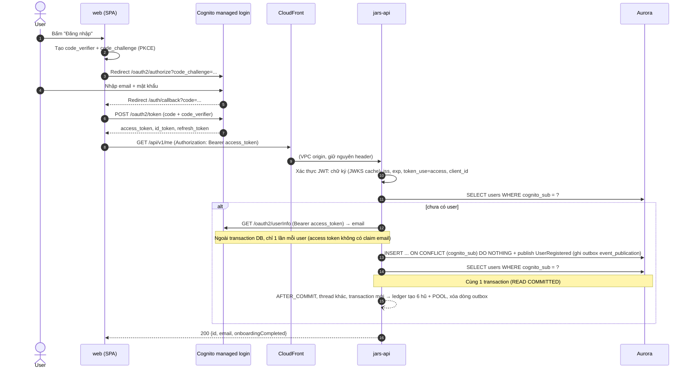
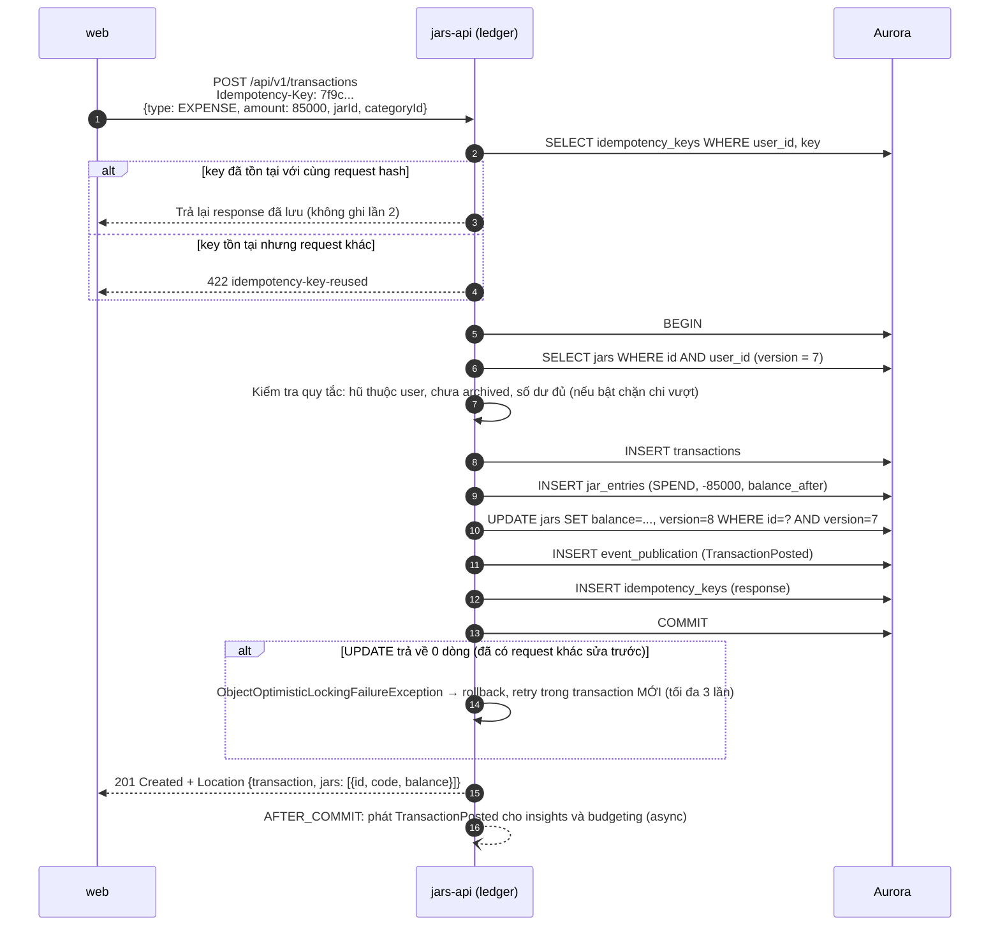
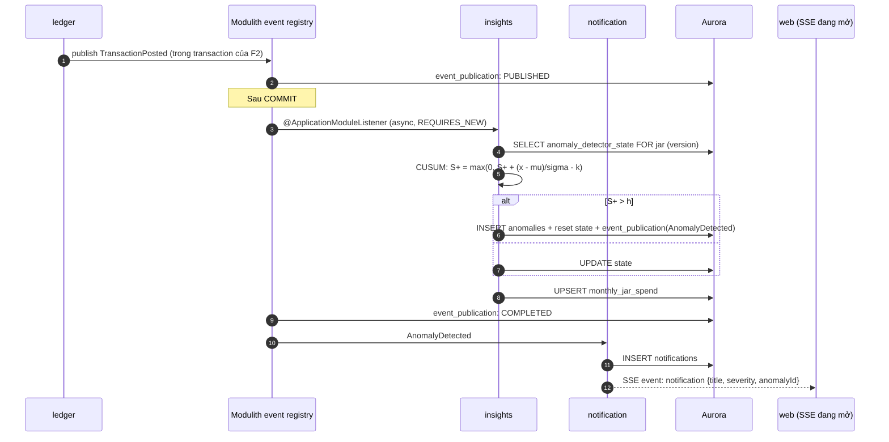
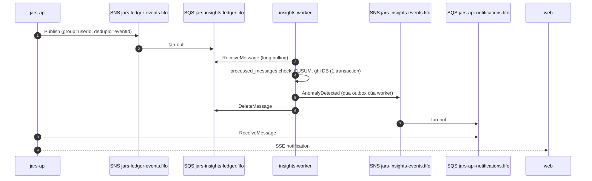
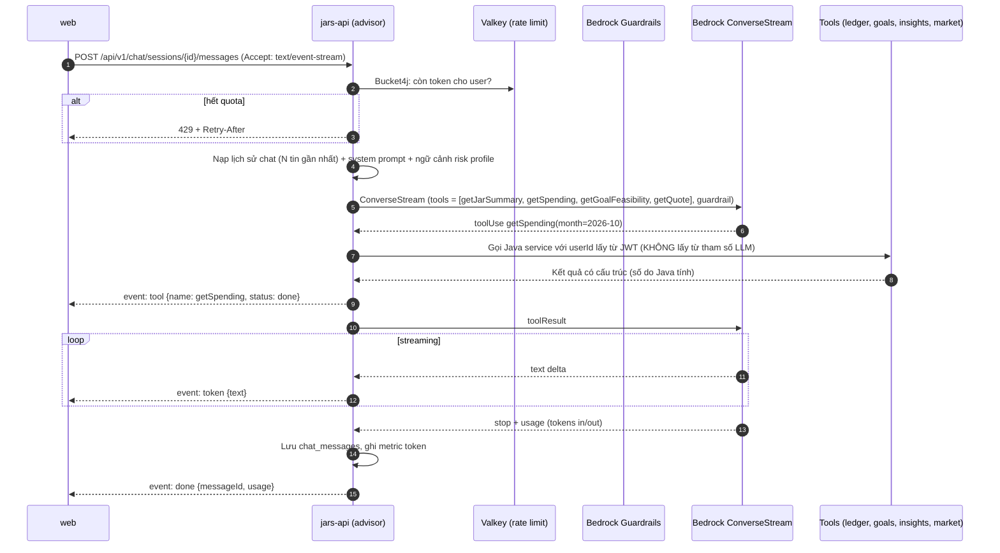
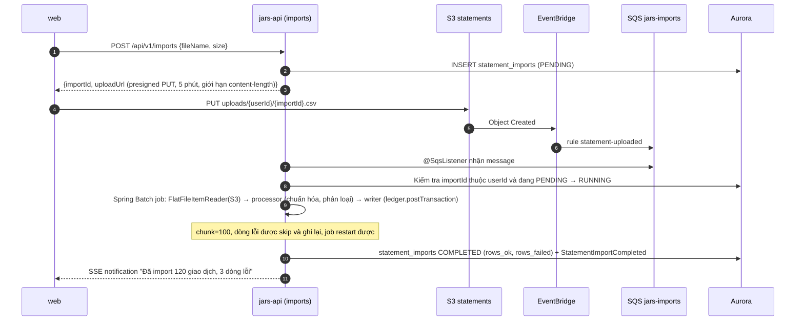
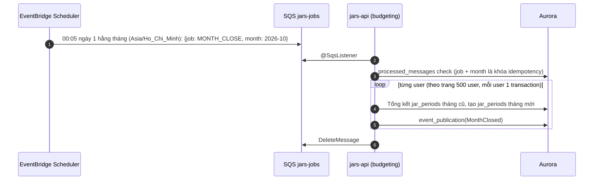
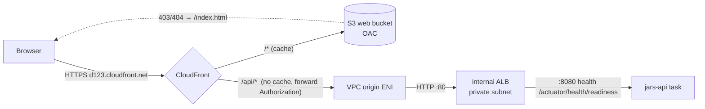

# Luồng chính (Runtime flows)

Mỗi luồng ghi rõ **có từ phase nào** và **điểm kỹ thuật cần học**. Ký hiệu: `CF` = CloudFront, `ALB` = internal ALB, `API` = jars-api.

| ID | Luồng | Phase |
|---|---|---|
| [F1](#f1) | Đăng nhập + request đầu tiên (tạo user lazy) | 1 |
| [F2](#f2) | Ghi một khoản chi (idempotency, optimistic lock, outbox) | 1 |
| [F3](#f3) | Phát hiện bất thường → thông báo realtime (SSE) | 2 (in-process), 5 (qua SNS/SQS) |
| [F4](#f4) | Chat AI streaming với tool calling + guardrails | 4 |
| [F5](#f5) | Import sao kê CSV | 2 (local), 3 (S3 + EventBridge) |
| [F6](#f6) | Khép sổ cuối tháng theo lịch | 3 |
| [F7](#f7) | Định tuyến request ở edge | 3 |
| [F8](#f8) | Aurora auto-pause / resume | 3 |

---

## F1. Đăng nhập + request đầu tiên

**Điểm cần học:**
- **PKCE** thay cho client secret, vì SPA không giữ được bí mật.
- API chỉ nhận **access token**. ID token dùng để hiển thị thông tin user ở frontend, không dùng để gọi API.
- **Race condition:** 2 request đầu tiên đến cùng lúc thì cả hai cùng thấy "chưa có user". Xử lý bằng `INSERT ... ON CONFLICT (cognito_sub) DO NOTHING` rồi SELECT lại. Transaction thứ hai **chờ** transaction thứ nhất commit (vì đụng unique index), rồi không làm gì, và SELECT sau đó thấy được dòng đã commit. *(Đã cài đặt ở P1.2; `UserProvisioningIntegrationTest` chạy 8 luồng cùng lúc: luôn ra 1 dòng, 1 event.)*
- **Email lấy từ `/oauth2/userInfo`**, vì access token của Cognito không có claim `email`. Gọi **ngoài** transaction DB (không giữ connection trong lúc chờ mạng); timeout 2 s connect, 3 s read.
- Spring Security xác thực JWT **offline** bằng JWKS được cache, nên không phải gọi Cognito ở mỗi request.
- **Hũ mặc định được tạo bất đồng bộ** (P1.4): `identity` không biết `ledger` tồn tại, chỉ phát `UserRegistered`. Event được ghi vào outbox **trong cùng transaction** tạo user, nên user được tạo thì event không thể mất; rollback thì không có event. Cái giá: response `/me` có thể về **trước** khi 7 hũ xuất hiện (vài chục ms). `GET /jars` (P1.5) phải xử lý trường hợp "chưa có hũ" (gọi lại đoạn code tạo hũ, vốn idempotent, hoặc trả danh sách rỗng để UI thử lại). Nếu listener lỗi, publication ở trạng thái `FAILED` và được gửi lại (`DefaultJarsProvisionerTests`).

---

## F2. Ghi một khoản chi (Transfer / quick add)

**Điểm cần học:** `@Transactional` (proxy, rollback rules), optimistic locking với `@Version`, isolation `READ COMMITTED` (mặc định của PostgreSQL) và vì sao nó đủ dùng khi đã có `@Version`, idempotency key, outbox.

**Đã cài đặt (P1.5)**, trừ Idempotency-Key (P1.6): `PostingService` lồng **retry → transaction → work** tường minh. Mỗi lần thử đọc lại hũ (số dư và version mới), nên một khoản chi bị retry có thể trả 422 `insufficient-jar-balance`; đây là kết quả đúng. `ConcurrentPostingIntegrationTest`: 2 khoản chi 60k tranh 100k → đúng 1 thành công; 8 luồng cùng chi → không mất cập nhật; 6 luồng chuyển ngược chiều → không deadlock, tổng tiền bảo toàn; sau mọi test `jars.balance = SUM(jar_entries.amount)`.

---

## F3. Phát hiện bất thường → thông báo realtime

### Phase 2–4 (in-process)

### Phase 5 (externalized, qua SNS/SQS)

**Fan-out SSE khi có nhiều task:** user có thể đang giữ kết nối SSE ở task A trong khi task B nhận message. Cách xử lý (Phase 4+): task nhận message publish lên kênh Valkey `notif:{userId}`, task nào đang giữ kết nối của user đó thì đẩy xuống. Khi chỉ có 1 task thì không cần.

---

## F4. Chat AI streaming

**Điểm cần học:**
- Tool chỉ đọc dữ liệu, và `userId` luôn lấy từ security context, nên prompt injection không đọc được dữ liệu của người khác.
- Guardrail chặn nội dung khuyến nghị mua/bán cổ phiếu cụ thể.
- Streaming bằng `Flux` (Spring AI) chuyển sang `SseEmitter` (MVC), hoặc trả `Flux<ServerSentEvent>` trực tiếp.
- Chi phí được kiểm soát nhờ rate limit + `max-tokens`.

---

## F5. Import sao kê CSV

---

## F6. Khép sổ cuối tháng

**Vì sao không dùng `@Scheduled`:** khi có 2 task, cả hai sẽ cùng chạy job (khi đó cần ShedLock). Đưa lịch ra EventBridge Scheduler thì chỉ có **một message**, và chỉ một task nhận được nó. Ngoài ra Scheduler hỗ trợ timezone, có retry và DLQ.

---

## F7. Định tuyến request ở edge

---

## F8. Aurora auto-pause / resume

```mermaid
stateDiagram-v2
    [*] --> Running: kết nối đầu tiên
    Running --> Running: còn kết nối hoặc đang có query
    Running --> Pausing: 300 s không còn kết nối nào
    Pausing --> Paused
    Paused --> Resuming: có yêu cầu kết nối mới
    Resuming --> Running: khoảng vài giây đến 15 s
    note right of Paused: Không tính phí ACU, chỉ tính storage
    note right of Running: $0.20 / ACU-giờ (min 0.5 ACU khi chạy)
```

Điều kiện để thật sự pause được: Hikari `minimum-idle=0`; health check của ALB không chạm DB; không có `@Scheduled` nào query DB; không mở pgAdmin hay DBeaver quên đóng; không dùng RDS Proxy.
