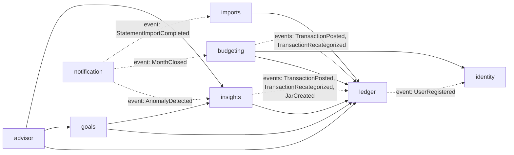

# Modules của `jars-api`

`jars-api` là một **modular monolith**: deploy thành một artifact duy nhất, nhưng bên trong chia thành các module có ranh giới rõ ràng. Spring Modulith kiểm tra ranh giới này trong test (`ApplicationModules.of(JarsApplication.class).verify()`), nên vi phạm sẽ làm **build fail**.

## 1. Quy ước package

```
io.github.thphuc06.jars
├── JarsApplication.java
├── shared/            # shared kernel (giữ thật nhỏ): Money, UserId, KeysetCursor, Uuids, DomainException, ProblemType, ProblemTypes
├── platform/          # hạ tầng cắt ngang: security (CurrentUser, JWT), audit, idempotency, observability, web (xem cuối §2)
├── identity/
│   ├── IdentityApi.java          # ← public: facade interface mà module khác được gọi
│   ├── UserRegistered.java       # ← public: domain event
│   └── internal/                 # ← mọi thứ khác: entity, repository, controller, service impl
├── ledger/
├── budgeting/
├── goals/
├── insights/
├── notification/
├── advisor/
└── imports/
```

**Quy tắc:**
1. Chỉ type nằm **ngay trong package gốc của module** mới là public. `internal/**` thì module khác không được import.
2. Module khác chỉ được: (a) gọi interface `XxxApi`, (b) nghe event public của module đó.
3. **Không chia sẻ JPA entity giữa các module.** Tham chiếu sang module khác bằng ID (ví dụ `UUID jarId`), không dùng `@ManyToOne` xuyên module.
4. Mỗi module tự sở hữu các bảng của mình (tiền tố tên bảng hoặc danh sách rõ ràng trong [data-model.md](data-model.md)). Module khác **không query bảng của nó**.
5. Controller REST nằm trong `internal/web`, DTO request/response là `record`.

## 2. Danh sách module

| Module | Trách nhiệm | Bảng sở hữu | API public (tóm tắt) | Event phát | Event nghe | Nguồn port từ project cũ |
|---|---|---|---|---|---|---|
| `identity` | Tạo user từ JWT (lazy), profile, bảng hỏi rủi ro | `users`, `risk_assessments` | `IdentityApi.userIdsAfter(cursor, limit)` (duyệt toàn bộ user theo trang, cho job khép sổ); `currentUser()`, `riskProfile(userId)` (dự kiến) | `UserRegistered`, `RiskProfileAssessed` (dự kiến) | – | `risk.py`, `suitability.py`, UI Onboarding |
| `ledger` | **Nguồn sự thật về tiền**: giao dịch, sổ cái hũ, số dư, danh mục | `transactions`, `jars`, `jar_entries`, `categories` | `LedgerApi`: `jars(userId)`, `categories(userId)`, `allocateIncome(userId, key, hash, IncomeAllocation)` (một khoản thu `INCOME` không gắn hũ + một bút toán `ALLOCATE` mỗi hũ, cùng một transaction, cùng cơ chế retry / idempotency / `TransactionPosted` như `POST /transactions`; tổng các phần phải đúng bằng số tiền, làm tròn là việc của bên gọi). `postTransaction`, `transferBetweenJars`, `balances` chưa có trong API public | `TransactionPosted`, `TransactionRecategorized`, `JarCreated` | `UserRegistered` (tạo 6 hũ mặc định); listener SQS `jars-reconciliation` (profile `aws`) chạy `ReconciliationService`: đối soát số dư hũ với tổng bút toán hằng đêm, chỉ phát hiện và báo, không tự sửa ([flows.md](flows.md) F6) | schema `jars`, `transactions` cũ |
| `budgeting` | Kế hoạch: gợi ý phân bổ thu nhập, áp dụng phân bổ, kế hoạch và thực chi theo tháng, khép sổ tháng | `jar_periods`, `allocation_decisions` | Chưa có interface `XxxApi`: module chỉ phát event `MonthClosed` ra ngoài. Gợi ý, áp dụng, xem kỳ và khép sổ là REST (`/budget/*`) và job SQS, logic nằm ở `internal/service` | `MonthClosed` | `TransactionPosted`, `TransactionRecategorized` (cập nhật `spent_amount` của kỳ) | `allocation.py` (rút gọn), `taxonomy.py` (bỏ) |
| `goals` | Mục tiêu, khả thi, what-if, lộ trình | `goals` | `GoalsApi.goals(userId)` (chỉ đọc, cho tool của advisor). Khả thi, what-if, lộ trình chỉ có qua REST (`/goals/*`) | `GoalCreated` | – | `goal.py`, `scenario.py`, `service_agent/*_engine`, `roadmap_compiler` |
| `insights` | Phân tích chi tiêu, phát hiện bất thường, read model cho dashboard | `anomaly_detector_state`, `anomalies`, `monthly_jar_spend`, `monthly_category_spend`, `monthly_cashflow` | `InsightsApi`: `monthlyCashflow(userId, lastMonths)` (thu chi theo tháng), `openAnomalyCount(userId)`, `openAnomalies(userId, limit)` (cảnh báo chưa xem xét, mới nhất trước), `spendingBehaviour(userId)` (chi tiêu tháng này theo danh mục so với trung bình 3 tháng trước). Dashboard, cảnh báo là REST | `AnomalyDetected` | `TransactionPosted`, `TransactionRecategorized`, `JarCreated` | `cusum_engine`, `anomaly.py` (MAD), `spend.py`, `recurring.py` |
| `notification` | Lưu thông báo, đẩy SSE, (tùy chọn) email SES | `notifications` | `stream(userId)` (REST/SSE) | – | `AnomalyDetected`, `MonthClosed` (đã cài), `StatementImportCompleted` | `tier1_notifications` cũ |
| `advisor` | Chat AI: phiên chat, tool calling chỉ đọc (user lấy từ JWT qua `ToolContext`), guardrail (`ApplyGuardrail`), rate limit trong PostgreSQL ([ADR-0023](../04-adr/0023-advisor-guardrail-and-rate-limit.md)) | `chat_sessions`, `chat_messages`, `advisor_usage` | – (chỉ có REST/SSE) | – | – | `agent/` (Strands), `kb/*.md` |
| `imports` | Import sao kê CSV: presigned URL, Spring Batch job (chunk 50, skip, retry, restart) | `statement_imports`, `statement_import_errors` (+ bảng metadata của Spring Batch) | Chưa có `XxxApi`: REST `/imports` và listener SQS; ghi vào ledger qua `LedgerApi.recordImported` (tham gia transaction của chunk) | `StatementImportCompleted` | SQS `jars-imports` | `ingest_statement_vn` |
| `shared` | Value object và tiện ích dùng chung | – | `Money`, `UserId`, `KeysetCursor`, `Uuids`, `DomainException`, `ProblemType`, `ProblemTypes` | – | – | – |

Thêm vào đó là các thành phần **hạ tầng không phải module nghiệp vụ**, nằm trong `io.github.thphuc06.jars.platform` (được Modulith đánh dấu là shared): cấu hình security, xử lý lỗi toàn cục, idempotency (bảng `idempotency_keys`), `Clock`, `CurrentUser` và JWT validator (`platform/security`), audit log (annotation `@Audited` + `AuditAspect`, ghi bảng `audit_log` cùng transaction với thao tác, [ADR-0025](../04-adr/0025-audit-log-aop-same-transaction.md)), cấu hình OpenTelemetry và `BusinessMetrics`. `shared` (`Money`, `UserId`, `ProblemTypes`) cũng được khai báo shared trong `@Modulithic`.

> **Đã cài đặt (P0.7):** `JarsApplication` có `@Modulithic(systemName = "Jars Platform", sharedModules = {"platform", "shared"})`; `platform/package-info.java` có `@ApplicationModule(displayName = "Platform (infrastructure)")`. `ModularityTests` gọi `verify()` ở mọi build và sinh diagram module vào `target/spring-modulith-docs` (`components.puml`).

## 3. Đồ thị phụ thuộc cho phép



Mũi tên liền là gọi API đồng bộ; mũi tên đứt là nghe event (mũi tên chỉ về **module phát** event). **Không được có vòng phụ thuộc.** Nếu A cần biết điều gì xảy ra ở B và B cũng cần A, thì một chiều phải chuyển thành event.

## 4. Vì sao `jars` và `transactions` cùng nằm trong `ledger`?

Ghi một khoản chi phải **trừ số dư hũ trong cùng một transaction DB**: không được có lúc giao dịch đã ghi mà hũ chưa trừ. Nếu tách hũ sang module `budgeting` thì phải chọn một trong hai:
- (a) gọi chéo module trong cùng transaction, gây coupling chặt;
- (b) cập nhật qua event, khi đó số dư bị *eventual consistency* và không chặn được chi vượt.

Gom vào `ledger` giúp tính nhất quán mạnh nằm gọn trong một module. `budgeting` chỉ giữ phần **kế hoạch** (tỷ lệ %, ngân sách tháng), là phần chấp nhận cập nhật trễ vài trăm ms.

## 5. Khi tách `insights` thành `insights-worker` (Phase 3+, backlog chưa lên lịch)

1. Event `TransactionPosted` được đánh dấu `@Externalized("jars-ledger-events.fifo::#{#this.userId()}")` → outbox → SNS FIFO.
2. Code của module `insights` chuyển nguyên sang `apps/insights-worker`. Bảng chuyển sang schema `insights`.
3. `jars-api` không còn module `insights`. Dashboard đọc read model qua... **quyết định khi làm backlog Phase 3+** (lựa chọn: worker ghi `monthly_jar_spend` vào schema `jars` thông qua event ngược lại, hoặc jars-api gọi API của worker). Ghi thành ADR khi đến lúc.
4. Module `notification` nghe `AnomalyDetected` từ SQS thay vì event in-process.

Nhờ ranh giới module đã được kiểm tra từ Phase 1, bước tách này chủ yếu là **di chuyển code**, không phải viết lại.
