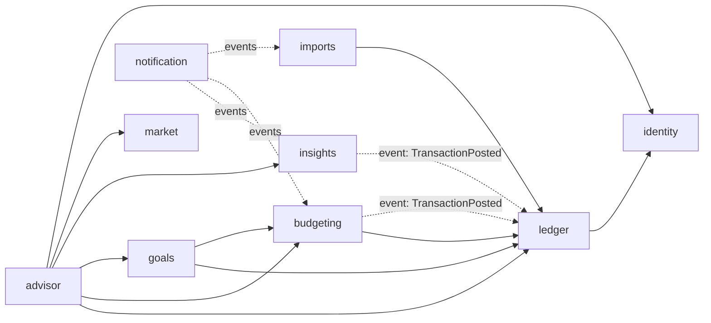

# Modules của `jars-api`

`jars-api` là một **modular monolith**: deploy thành một artifact duy nhất, nhưng bên trong chia thành các module có ranh giới rõ ràng. Spring Modulith kiểm tra ranh giới này trong test (`ApplicationModules.of(JarsApplication.class).verify()`), nên vi phạm sẽ làm **build fail**.

## 1. Quy ước package

```
io.github.thphuc06.jars
├── JarsApplication.java
├── shared/            # shared kernel: Money, UserId, ProblemTypes, SecurityUtils (giữ thật nhỏ)
├── identity/
│   ├── IdentityApi.java          # ← public: facade interface mà module khác được gọi
│   ├── UserRegistered.java       # ← public: domain event
│   ├── CurrentUser.java          # ← public: DTO (record)
│   └── internal/                 # ← mọi thứ khác: entity, repository, controller, service impl
├── ledger/
├── budgeting/
├── goals/
├── insights/
├── notification/
├── advisor/
├── market/
└── imports/
```

**Quy tắc:**
1. Chỉ type nằm **ngay trong package gốc của module** mới là public. `internal/**` thì module khác không được import.
2. Module khác chỉ được: (a) gọi interface `XxxApi`, (b) nghe event public của module đó.
3. **Không chia sẻ JPA entity giữa các module.** Tham chiếu sang module khác bằng ID (ví dụ `UUID jarId`), không dùng `@ManyToOne` xuyên module.
4. Mỗi module tự sở hữu các bảng của mình (tiền tố tên bảng hoặc danh sách rõ ràng trong [data-model.md](data-model.md)). Module khác **không query bảng của nó**.
5. Controller REST nằm trong `internal/web`, DTO request/response là `record`.

## 2. Danh sách module

| Module | Trách nhiệm | Bảng sở hữu | API public (tóm tắt) | Event phát | Event nghe | Nguồn port từ project cũ |
|---|---|---|---|---|---|---|
| `identity` | Tạo user từ JWT (lazy), profile, bảng hỏi rủi ro | `users`, `risk_assessments` | `currentUser()`, `riskProfile(userId)` | `UserRegistered`, `RiskProfileAssessed` | – | `risk.py`, `suitability.py`, UI Onboarding |
| `ledger` | **Nguồn sự thật về tiền**: giao dịch, sổ cái hũ, số dư, danh mục | `transactions`, `jars`, `jar_entries`, `categories`, `idempotency_keys` | `postTransaction(cmd)`, `transferBetweenJars(cmd)`, `jars(userId)`, `balances(...)` | `TransactionPosted`, `TransactionRecategorized`, `JarCreated` | `UserRegistered` (tạo 6 hũ + hũ ẩn `POOL`) | schema `jars`, `transactions` cũ |
| `budgeting` | Kế hoạch: tỷ lệ % mỗi hũ, ngân sách tháng, gợi ý phân bổ, khép sổ tháng | `jar_periods`, `allocation_decisions` | `suggestAllocation(userId)`, `closeMonth(userId, month)` | `MonthClosed` | `TransactionPosted` (cập nhật đã chi trong kỳ) | `allocation.py`, `taxonomy.py` |
| `goals` | Mục tiêu, khả thi, what-if, lộ trình | `goals` | `feasibility(goalId)`, `scenarios(goalId)`, `roadmap(goalId)` | `GoalCreated` | – | `goal.py`, `scenario.py`, `service_agent/*_engine`, `roadmap_compiler` |
| `insights` | Phân tích chi tiêu, phát hiện bất thường, read model cho dashboard | `anomaly_detector_state`, `anomalies`, `monthly_jar_spend` | `dashboard(userId, month)`, `spendBreakdown(...)` | `AnomalyDetected` | `TransactionPosted`, `TransactionRecategorized` | `cusum_engine`, `anomaly.py` (MAD), `spend.py`, `recurring.py` |
| `notification` | Lưu thông báo, đẩy SSE, (tùy chọn) email SES | `notifications` | `stream(userId)` | – | `AnomalyDetected`, `MonthClosed`, `StatementImportCompleted` | `tier1_notifications` cũ |
| `advisor` | Chat AI: phiên chat, tool calling, guardrails, rate limit | `chat_sessions`, `chat_messages` | – (chỉ có REST/SSE) | – | – | `agent/` (Strands), `kb/*.md` |
| `market` | Gateway tới `quant-fn`, cache giá | – | `quote(symbol)`, `history(...)`, `optimize(...)` | – | – | `vnstock_service.py`, `pypfopt_optimizer.py` (vẫn chạy bằng Python) |
| `imports` | Import sao kê CSV: presigned URL, Spring Batch job | `statement_imports` (+ bảng metadata của Spring Batch) | `createUpload(userId)` | `StatementImportCompleted` | SQS `jars-imports` | `ingest_statement_vn` |
| `shared` | Value object và tiện ích dùng chung | – | `Money`, `UserId`, `Month`, `ProblemTypes` | – | – | – |

Thêm vào đó là các thành phần **hạ tầng không phải module nghiệp vụ**, nằm trong `io.github.thphuc06.jars.platform` (được Modulith đánh dấu là shared): cấu hình security, xử lý lỗi toàn cục, audit (AOP), cấu hình OpenTelemetry.

> **Đã cài đặt (P0.7):** `JarsApplication` có `@Modulithic(systemName = "Jars Platform", sharedModules = {"platform", "shared"})`; `platform/package-info.java` có `@ApplicationModule(displayName = "Platform (infrastructure)")`. `ModularityTests` gọi `verify()` ở mọi build và sinh diagram module vào `target/spring-modulith-docs` (`components.puml`).
>
> **Đã cài đặt (P1.10):** `platform.web` có thêm phần mô tả API: `OpenApiConfiguration` (info, server tương đối `/`, security scheme bearer, schema `Problem`), `DtoSchemaConverter` (JSpecify `@Nullable` → nullable, `@VndAmount` → string) và `ApiContractRules` (security theo method giống `SecurityConfig`, 401/403/`default`, header idempotency, response luôn `required`). Module nghiệp vụ không phụ thuộc springdoc: controller không có annotation `@Schema`/`@Operation` nào ([ADR-0019](../04-adr/0019-code-first-openapi-contract.md)).
>
> **Đã cài đặt (P1.9):** `GET /dashboard` và `GET /balances/daily` **tạm nằm trong `ledger`** (`DashboardQueries`, aggregate SQL trên bảng của chính ledger), vì `insights` chưa có read model mà cũng không được đọc bảng của ledger. Ở P2.3, dashboard chuyển sang `insights`, đọc `monthly_jar_spend` cập nhật bằng event `TransactionPosted`/`TransactionRecategorized`; đường dẫn API giữ nguyên.
>
> **Đã cài đặt (P1.8):** API public đầu tiên giữa 2 module nghiệp vụ: `ledger.LedgerApi` (`jars(userId)`, `jar(userId, jarId)` → `JarSummary`, `code` là string để enum `JarCode` vẫn nằm trong ledger). `goals` có `allowedDependencies = {identity, ledger, shared}`; danh sách mục tiêu gọi `jars(userId)` **một lần** rồi ghép trong bộ nhớ (tránh N+1 xuyên module). Đã thử: `goals` dùng `ledger.internal.LedgerQueries` thì `verify()` báo vi phạm. `MoneyFormat` và `BusinessTime` (giờ VN) chuyển vào `shared`.
>
> **Đã cài đặt (P1.4):** đồ thị ở §3 được kiểm tra bằng `@ApplicationModule(allowedDependencies = ...)` trên từng module (bắt đầu từ `ledger = {identity, shared}`). Đã thử: `ledger` dùng `platform.security.SecurityConfig` thì `verify()` báo vi phạm. Lưu ý: shared module (`platform`, `shared`) được tự động cho phép, nhưng **chỉ phần base**; named interface như `platform :: security` vẫn phải khai báo rõ.

## 3. Đồ thị phụ thuộc cho phép



Mũi tên liền là gọi API đồng bộ; mũi tên đứt là nghe event (mũi tên chỉ về **module phát** event). **Không được có vòng phụ thuộc.** Nếu A cần biết điều gì xảy ra ở B và B cũng cần A, thì một chiều phải chuyển thành event.

## 4. Vì sao `jars` và `transactions` cùng nằm trong `ledger`?

Ghi một khoản chi phải **trừ số dư hũ trong cùng một transaction DB**: không được có lúc giao dịch đã ghi mà hũ chưa trừ. Nếu tách hũ sang module `budgeting` thì phải chọn một trong hai:
- (a) gọi chéo module trong cùng transaction, gây coupling chặt;
- (b) cập nhật qua event, khi đó số dư bị *eventual consistency* và không chặn được chi vượt.

Gom vào `ledger` giúp tính nhất quán mạnh nằm gọn trong một module. `budgeting` chỉ giữ phần **kế hoạch** (tỷ lệ %, ngân sách tháng), là phần chấp nhận cập nhật trễ vài trăm ms.

## 5. Khi tách `insights` thành `insights-worker` (Phase 5)

1. Event `TransactionPosted` được đánh dấu `@Externalized("jars-ledger-events.fifo::#{#this.userId()}")` → outbox → SNS FIFO.
2. Code của module `insights` chuyển nguyên sang `apps/insights-worker`. Bảng chuyển sang schema `insights`.
3. `jars-api` không còn module `insights`. Dashboard đọc read model qua... **quyết định ở Phase 5** (lựa chọn: worker ghi `monthly_jar_spend` vào schema `jars` thông qua event ngược lại, hoặc jars-api gọi API của worker). Ghi thành ADR khi đến lúc.
4. Module `notification` nghe `AnomalyDetected` từ SQS thay vì event in-process.

Nhờ ranh giới module đã được kiểm tra từ Phase 1, bước tách này chủ yếu là **di chuyển code**, không phải viết lại.
