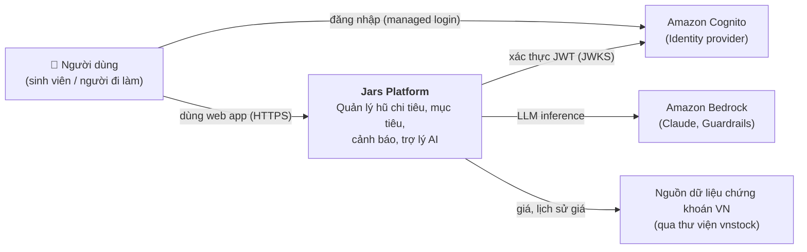
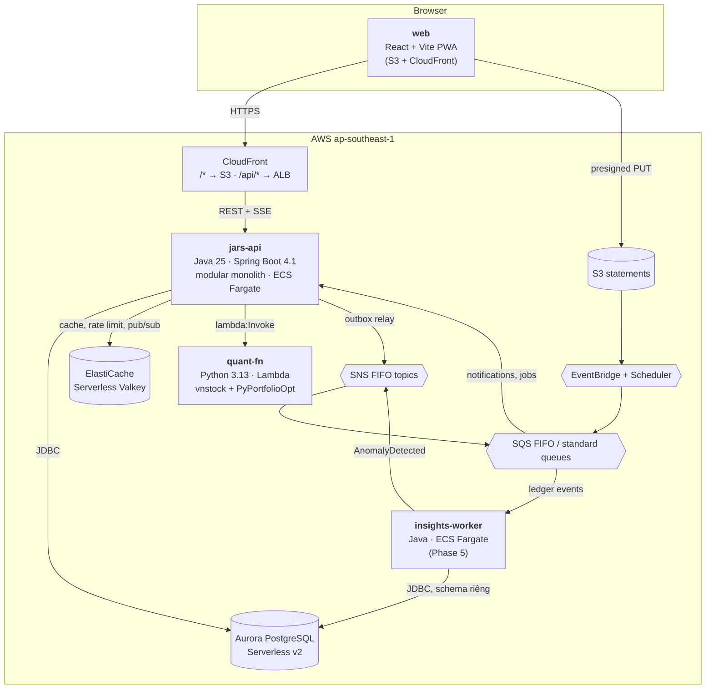

# Architecture Overview

> Tài liệu này mô tả **kiến trúc đích** và cách nó **tiến hóa qua từng phase**. Lý do chi tiết của từng lựa chọn nằm trong [ADR](../04-adr/README.md), còn chi tiết hạ tầng nằm ở [aws-infrastructure.md](aws-infrastructure.md).

## 1. Nguyên tắc thiết kế

| # | Nguyên tắc | Hệ quả cụ thể |
|---|---|---|
| P1 | **Monolith trước, tách sau khi có lý do** | Một `jars-api` chia module bằng Spring Modulith. Chỉ tách `insights-worker` ở Phase 5, vì phần này vốn bất đồng bộ và có thể chạy trễ hơn ([ADR-0003](../04-adr/0003-modular-monolith-spring-modulith.md)) |
| P2 | **Tiền là dữ liệu nghiêm túc** | `BigDecimal` + `NUMERIC(19,2)`, sổ cái hũ chỉ ghi thêm (append-only), optimistic locking, idempotency key ([ADR-0014](../04-adr/0014-money-and-ledger-model.md)) |
| P3 | **LLM không bao giờ tự tính tiền** | AI chỉ gọi tool (code Java) để lấy số liệu, rồi diễn giải. Tool chỉ đọc và chỉ thấy dữ liệu của chính user ([ADR-0011](../04-adr/0011-ai-spring-ai-bedrock.md)) |
| P4 | **AWS-native, serverless khi có thể** | Ưu tiên dịch vụ managed, tính tiền theo mức dùng (Aurora scale-to-zero, SQS, Lambda). Không tự vận hành Kafka hay Kubernetes |
| P5 | **Rẻ khi ngủ, đủ khi demo** | Không dùng NAT Gateway; ECS scale về 0 được; Aurora tự pause ([ADR-0013](../04-adr/0013-networking-no-nat.md), [cost-and-budget](../05-operations/cost-and-budget.md)) |
| P6 | **Một cửa vào duy nhất** | CloudFront là domain duy nhất cho cả UI lẫn API → cùng origin → không cần CORS. ALB đặt internal, không lộ ra internet ([ADR-0007](../04-adr/0007-edge-cloudfront-vpc-origin.md)) |
| P7 | **At-least-once + idempotent** | Mọi consumer event đều chịu được message trùng (bảng `processed_messages`). Outbox đảm bảo không mất event |
| P8 | **Hạ tầng là code, tài liệu là code** | 100% hạ tầng nằm trong CDK (Java); diagram và tài liệu sống trong repo |
| P9 | **Python chỉ ở nơi Python thắng** | vnstock và PyPortfolioOpt không có bản Java tương đương → đóng gói thành một Lambda nhỏ, giao tiếp qua JSON contract |

## 2. C4 Level 1: System Context

## 3. C4 Level 2: Containers

| Container | Công nghệ | Trách nhiệm | Có từ phase |
|---|---|---|---|
| `web` | React 18, Vite 8, shadcn/ui, TanStack Query, `oidc-client-ts` ([ADR-0020](../04-adr/0020-spa-auth-oidc-client-ts.md)), `openapi-fetch` | UI/PWA. Gọi `/api/*` qua cùng domain | 1 |
| `jars-api` | Java 25, Spring Boot 4.1, Modulith | Toàn bộ nghiệp vụ: identity, ledger, budgeting, goals, insights (đến Phase 4), notification, advisor (AI), market gateway, imports | 0 |
| `insights-worker` | Java 25, Spring Boot 4.1, Spring Cloud AWS SQS | Nhận `TransactionPosted`, chạy CUSUM/MAD, cập nhật read model, phát `AnomalyDetected` | 5 |
| `quant-fn` | Python 3.13, AWS Lambda (container image, arm64) | Lấy giá và lịch sử giá (vnstock), tối ưu danh mục (PyPortfolioOpt). Stateless | 4 |

Phân rã chi tiết bên trong `jars-api`: [modules.md](modules.md).

## 4. Tech stack và version

Version được chốt ngày **2026-10-23** theo bản stable mới nhất. Cột "Đã xác minh" ghi những gì đã kiểm tra thật, những gì còn phải kiểm tra ở Phase 0.

| Thành phần | Version | Ghi chú | Đã xác minh |
|---|---|---|---|
| JDK | **25 LTS** (Eclipse Temurin) | JDK 27 (9/2026) không phải LTS. Bật virtual threads | ✅ JDK 25 là LTS hiện hành |
| Spring Boot | **4.1.x** (mới nhất: 4.1.2) | Framework 7, Jackson 3, có starter OpenTelemetry | ✅ tag `v4.1.2` trên GitHub |
| Spring Modulith | **2.1.x** (2.1.2) | Event publication registry (outbox), `@ApplicationModuleTest` | ✅ |
| Spring AI | **2.0.x** (2.0.1) | `spring-ai-starter-model-bedrock-converse`, tool calling, streaming | ✅ GA 12/06/2026 |
| Spring Cloud AWS | **4.2.x** (4.2.0) | SQS listener, SNS, S3, Secrets Manager, `spring-cloud-aws-modulith-events-sns/sqs` | ✅ Smoke test P0.5 với Boot 4.1.2: Secrets Manager import + SQS listener chạy được (bảng tương thích chính thức chỉ ghi Boot 4.0.x). Cần thêm `software.amazon.awssdk:signin` (runtime) để đọc credential `aws login` |
| Spring Batch | theo BOM của Boot | Import CSV | – |
| Flyway | theo BOM của Boot | Migration | – |
| PostgreSQL | Aurora PostgreSQL **17.x** | Scale-to-zero yêu cầu ≥ 16.3 / 15.7 | ⚠️ Kiểm tra minor version khả dụng ở ap-southeast-1 khi deploy |
| Resilience4j | 2.x | Circuit breaker cho `quant-fn`. Spring Framework 7 đã có sẵn `@Retryable` / `@ConcurrencyLimit` | ⚠️ Kiểm tra starter cho Boot 4 ở Phase 4 |
| springdoc-openapi | **3.1.x** (3.1.1) | Sinh OpenAPI 3.1 → `contracts/openapi/jars-api.yaml` → TypeScript client | ✅ P1.10 với Boot 4.1.2 + Jackson 3 (3.1.1 build trên Boot 4.1.0). 3.2.0 (24/10/2026, build trên 4.1.2) để Dependabot nâng sau |
| Testcontainers | 2.x | PostgreSQL, LocalStack (cần auth token, xem local-development) | – |
| AWS CDK | v2 (Java) | `aws-cdk-lib` | ✅ Account đã từng dùng CDK (stack `CDKToolkit` ở us-east-1) |
| Node.js | 22/24 LTS | Build web, chạy CDK CLI qua `npx` | ✅ máy dev có Node 24 |
| Python | 3.13 | `quant-fn` | – |
| Bedrock model | `global.anthropic.claude-haiku-4-5-20251001-v1:0` (mặc định), `global.anthropic.claude-sonnet-4-6` (khi cần chất lượng cao) | Global cross-region inference profile | ✅ **gọi thật** bằng Spring AI ở P0.5 (Haiku 5.5: AccessDenied) |
| Embedding (tùy chọn) | `cohere.embed-multilingual-v3` | Hỗ trợ tiếng Việt, dùng cho RAG | ✅ có ở ap-southeast-1 |

## 5. Kiểu giao tiếp

| Từ → Đến | Kiểu | Lý do |
|---|---|---|
| web → jars-api | REST JSON (`/api/v1/**`), lỗi theo chuẩn RFC 9457 `ProblemDetail` | Đơn giản, có OpenAPI để sinh client |
| web ← jars-api (chat, thông báo) | **SSE** (`text/event-stream`), client dùng `fetch` để gửi được header `Authorization` | Luồng 1 chiều server → client; chạy qua ALB/CloudFront không cần cấu hình đặc biệt ([ADR-0015](../04-adr/0015-realtime-sse.md)) |
| module ↔ module (trong jars-api) | Gọi trực tiếp API public của module (đồng bộ) **hoặc** domain event in-process (bất đồng bộ, qua outbox) | Spring Modulith kiểm tra ranh giới |
| jars-api → insights-worker | Event: outbox → SNS FIFO → SQS FIFO (message group = `userId`) | Thứ tự theo từng user, at-least-once ([ADR-0009](../04-adr/0009-messaging-sns-sqs-eventbridge.md)) |
| S3 / Scheduler → jars-api | EventBridge → SQS → `@SqsListener` | Có buffer, có retry và DLQ |
| jars-api → quant-fn | `lambda:Invoke` đồng bộ qua AWS SDK, có timeout + circuit breaker | Xác thực bằng IAM, không cần public endpoint |
| jars-api → Bedrock | `ConverseStream` qua Spring AI | Streaming token về SSE |

## 6. Thuộc tính chất lượng và chiến thuật

| Thuộc tính | Mục tiêu (dev) | Chiến thuật |
|---|---|---|
| Đúng đắn của tiền | 0 lỗi lệch số dư | Transaction ACID, `@Version`, ledger append-only, test bất biến "tổng entry = balance" |
| Bảo mật | Không lộ dữ liệu chéo user (IDOR) | Mọi query lọc theo `userId` lấy từ JWT; có test IDOR; ALB internal; SG khóa chặt ([security.md](security.md)) |
| Độ trễ API | p95 < 300 ms (không tính lúc Aurora vừa resume) | Index đúng, keyset pagination, cache dashboard |
| Chat | Token đầu tiên < 2 s | Streaming, model Haiku |
| Khả dụng | Best effort (dev) | ECS circuit breaker tự rollback; event không mất nhờ outbox + DLQ |
| Chi phí | ≈ $1/tháng khi teardown; ≤ $75/tháng khi chạy đủ (Phase 5) | Fargate ARM, không NAT, Aurora scale-to-zero, chế độ TEARDOWN mặc định, budget alarm |
| Quan sát được | Trace xuyên suốt request → event → consumer | OpenTelemetry, `traceparent` truyền trong message attributes |
| Dễ thay đổi | Thêm feature không phá module khác | Kiểm tra ranh giới bằng Modulith + ArchUnit trong test |

## 7. Kiến trúc tiến hóa theo phase

| Phase | Hình dạng hệ thống | Hạ tầng |
|---|---|---|
| 0–2 | `jars-api` chạy local; event in-process qua Modulith registry; Postgres + Valkey bằng docker compose | Chỉ deploy `JarsAuth` (Cognito, miễn phí) để lấy JWT thật |
| 3 | Deploy MVP ([diagram](../diagrams/aws-phase3-mvp.png)) | Foundation, Network, Data, Messaging (S3 → EventBridge → SQS, Scheduler), App |
| 4 | Thêm advisor (Bedrock), market (quant-fn), cache | + Valkey, + `JarsQuant`, + Guardrails |
| 5 | Externalize event; tách `insights-worker` | + SNS FIFO / SQS FIFO + DLQ, + service ECS thứ hai |
| 6 | Observability đầy đủ, blue/green, load test | + ADOT/X-Ray, dashboard, alarm; (tùy chọn) WAF |

## 8. Những gì cố ý KHÔNG dùng

| Không dùng | Thay bằng | Lý do |
|---|---|---|
| App Runner | ECS Fargate | Ngừng nhận khách hàng mới từ 30/04/2026 ([ADR-0006](../04-adr/0006-compute-ecs-fargate.md)) |
| Amazon MSK (Kafka) | SNS FIFO + SQS FIFO | MSK Serverless khoảng $0.75/giờ cluster (~$550/tháng) > toàn bộ credit. Kiến thức Kafka học ở lab local ([ADR-0009](../04-adr/0009-messaging-sns-sqs-eventbridge.md)) |
| EKS | ECS | Control plane khoảng $73/tháng; K8s để học ở local bằng kind (tùy chọn) |
| NAT Gateway | Task ở public subnet + SG khóa chặt | $0.059/giờ ≈ $43/tháng ở Singapore ([ADR-0013](../04-adr/0013-networking-no-nat.md)) |
| Supabase | Aurora PostgreSQL | Yêu cầu AWS-native; dữ liệu đi qua backend có kiểm soát quyền |
| Bedrock AgentCore / Strands / MCP gateway (của bản cũ) | Spring AI trong jars-api | Bài toán chỉ cần gọi tool và stream; giảm 3 runtime xuống còn 0 |
| Dexter (agent TypeScript) | quant-fn + tool trong advisor | Fork của bên thứ ba, không phải năng lực Java |
