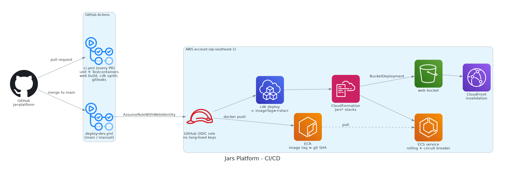

# Deployment



## 1. Chuẩn bị tài khoản (làm 1 lần)

> Làm ở **Phase 0**. Các bước đều **miễn phí**.

| # | Việc | Vì sao | Cách làm |
|---|---|---|---|
| 1 | Bật **MFA cho root**, ngừng dùng root cho CLI | CLI hiện đăng nhập bằng `arn:aws:iam::626212071763:root`. Root lộ thì mất toàn bộ tài khoản | Console → Security credentials → MFA; xóa access key của root nếu có |
| 2 | **Bật MFA cho IAM user `phuc-account`**, sau đó **vô hiệu hóa** access key dài hạn của user này ([ADR-0018](../04-adr/0018-human-access-iam-user-aws-login.md)). Identity Center **không dùng được** vì cần Organizations, mà Organizations làm mất credit | Không còn credential dài hạn; tài khoản admin có MFA | Console → IAM → Users → `phuc-account` → Security credentials → Assign MFA device; Access keys → Deactivate |
| 3 | `aws login --profile jars-dev` (đăng nhập bằng `phuc-account`, region `ap-southeast-1`) | CLI/SDK dùng credential tạm thời (tối đa 12 giờ) | [local-development.md §5](local-development.md#5-aws-credentials-cho-local-không-dùng-root) |
| 4 | Bật cost allocation tag `Project` | Lọc chi phí theo project | Billing → Cost allocation tags (tag xuất hiện sau khi resource đầu tiên được gắn tag, mất tới 24 giờ) |
| 5 | Kiểm tra **Bedrock model access** ở ap-southeast-1 | Gọi model lần đầu cần được phép | Console Bedrock → Model access (hoặc thử gọi `converse` bằng CLI) |
| 6 | `npx aws-cdk@2 bootstrap aws://626212071763/ap-southeast-1 --profile jars-dev` | CDK cần bucket và role bootstrap ở mỗi region | Hiện mới bootstrap ở us-east-1 |
| 7 | Tạo repo GitHub `thphuc06/jar-platform` (repo cá nhân), bật secret scanning + push protection | Chặn commit secret | Settings → Code security |
| 8 | Bật **S3 Block Public Access ở cấp account** | Không bucket nào lỡ bị public | S3 console → Block Public Access settings for this account |
| 9 | Bật **EBS encryption by default** (ap-southeast-1) | Volume mới tự được mã hóa (instance `sidewalk` hiện có cũng có EBS) | EC2 console → Settings → EBS encryption |
| 10 | Tạo **IAM Access Analyzer** loại external access (cấp account) | Phát hiện resource bị chia sẻ ra ngoài; miễn phí | IAM → Access Analyzer → Create analyzer |
| 11 | Bật **Cost Anomaly Detection** (monitor theo service + email hằng ngày) | Cảnh báo chi phí tăng bất thường; không tính phí | Billing → Cost Anomaly Detection |

> **Bước 8–11 là "account baseline"**, không thuộc CDK stack nào của project. Chúng bảo vệ **cả account dùng chung** (có cả `sidewalk`, `FairTable`). Nếu đặt vào `JarsFoundation` thì `cdk destroy` sẽ gỡ luôn bảo vệ của các project khác, và tài nguyên tạo bằng tay sẽ bị trùng. Các bước này làm một lần bằng console hoặc CLI, rồi ghi lại trạng thái ở đây.

Tham chiếu đầy đủ: [well-architected-review.md](../02-architecture/well-architected-review.md).

> **Lưu ý:** **Không** tham gia AWS Organizations hay Control Tower với tài khoản này. Theo FAQ của AWS Free Tier, làm vậy khiến credit **hết hạn ngay lập tức**.

## 2. Thứ tự deploy

| Lần | Lệnh | Khi nào |
|---|---|---|
| Phase 1 | `cdk deploy JarsAuth` | Cần Cognito để có JWT thật khi chạy local |
| Phase 3, lần đầu | `cdk deploy JarsFoundation JarsNetwork JarsData JarsMessaging` | Hạ tầng nền (ECR, VPC, Aurora, SQS) |
| Phase 3 | Push image đầu tiên lên ECR (bằng CI hoặc tay), rồi `cdk deploy JarsApp -c imageTag=<sha>` | Lên app |
| Phase 4 | `cdk deploy JarsQuant JarsApp` | Thêm quant-fn, Valkey, quyền Bedrock |
| Phase 5 | `cdk deploy JarsMessaging JarsApp` (+ service worker) | SNS/SQS FIFO + insights-worker |
| Phase 6 | `cdk deploy JarsObservability` | Dashboard, alarm |

Tất cả lệnh chạy trong `infra/cdk` với `--profile jars-dev`. Trước mỗi lần deploy nên chạy `cdk diff` để xem thay đổi.

## 3. Cấu hình theo môi trường (`infra/cdk/cdk.json` → `context`)

| Key | Mặc định | Ý nghĩa |
|---|---|---|
| `env` | `dev` | Tiền tố tên resource |
| `account` / `region` | `626212071763` / `ap-southeast-1` | |
| `imageTag` | (bắt buộc với `JarsApp`) | Git SHA của image jars-api |
| `apiDesiredCount` | `1` | `0` = chế độ SLEEP |
| `dbMode` | `aurora` | `rds` = chuyển sang RDS t4g.micro dự phòng (ADR-0008) |
| `enableCache` | `false` (Phase 3) / `true` (Phase 4+) | Tạo Valkey Serverless |
| `customDomain` | (trống) | Nếu có domain riêng: tạo ACM ở us-east-1 + bản ghi Route 53 |
| `alertEmail` | (email của bạn) | Nhận budget alarm và CloudWatch alarm |

## 4. Pipeline

### `ci.yml` (mỗi PR và mỗi lần push lên `main`)

**Đang có (P0.8):** [`.github/workflows/ci.yml`](../../.github/workflows/ci.yml)

| Job | Làm gì | Ghi chú |
|---|---|---|
| `jars-api` | `setup-java` Temurin 25 (có cache Maven) → `./mvnw --batch-mode --no-transfer-progress verify` | `verify` gồm unit test + Testcontainers (Docker của runner) + Modulith `verify()` + Spotless check. Fail thì upload `surefire-reports`; pass thì upload `modulith-docs` |
| `gitleaks` | Quét **toàn bộ lịch sử** git (`fetch-depth: 0`) | Action pin theo commit SHA (v3.0.0); tắt comment vào PR nên chỉ cần quyền `contents: read`; repo cá nhân nên không cần license |

Toàn workflow: `permissions: contents: read`; dùng `concurrency` để push mới hủy lần chạy cũ; mỗi job có `timeout-minutes`. Cấu hình [`.github/dependabot.yml`](../../.github/dependabot.yml) mở PR cập nhật Maven và Actions hằng tuần (gom nhóm Spring và Spring Cloud AWS để các version khớp nhau luôn đi cùng).

**Thêm sau** (khi có app tương ứng, khi đó dùng path filter để chỉ build phần bị thay đổi):

```
paths: apps/web/**           → npm ci → lint → test → build                 (P1.11)
paths: functions/quant-fn/** → pip install → pytest                           (P4.2)
paths: infra/cdk/**          → ./mvnw test (CDK assertions) → cdk synth (cdk-nag) (P1.1)
```

Kiểm tra workflow ở local trước khi push: `docker run --rm -v "$PWD:/repo" -w /repo rhysd/actionlint:1.7.12`. Quét secret ở local: `docker run --rm -v "$PWD:/repo" ghcr.io/gitleaks/gitleaks:v8.30.1 git /repo --redact`.

### `deploy-dev.yml` (merge `main` hoặc `workflow_dispatch`)

```
permissions: id-token: write, contents: read
1. aws-actions/configure-aws-credentials (role-to-assume: jars-github-deploy, region ap-southeast-1)
2. docker buildx build --platform linux/arm64 -t <ecr>/jars/jars-api:${GITHUB_SHA} --push
3. cd infra/cdk && npx aws-cdk@2 deploy JarsApp JarsQuant -c imageTag=${GITHUB_SHA} --require-approval never
4. (BucketDeployment trong JarsApp upload apps/web/dist và invalidate CloudFront)
5. Smoke test: curl https://<cf-domain>/api/v1/health → 200
```

> Workflow deploy **không tự chạy khi đang TEARDOWN**. Dùng biến repo `DEPLOY_ENABLED=false` để bỏ qua bước deploy, tránh vô tình dựng lại stack tốn tiền.

## 5. Chiến lược release và rollback

| Cơ chế | Mô tả |
|---|---|
| ECS deployment circuit breaker (`rollback=true`) | Task mới không healthy thì ECS tự quay về task definition cũ |
| `minimumHealthyPercent=100`, `maximumPercent=200` | Task mới healthy rồi mới tắt task cũ (zero-downtime với 1 task) |
| Rollback thủ công | `cdk deploy JarsApp -c imageTag=<sha-cũ>` |
| DB migration | Flyway chạy lúc app khởi động. **Migration phải backward-compatible** (expand → migrate → contract) để rollback image không làm hỏng DB |
| Blue/green (Phase 6) | Thử ECS native blue/green với test listener + lifecycle hook (Lambda smoke test) |

## 6. Checklist sau deploy

- [ ] `GET /api/v1/health` trả 200 qua CloudFront.
- [ ] Đăng nhập bằng managed login → `GET /api/v1/me` trả 200.
- [ ] Gọi thẳng DNS của ALB từ internet → **không kết nối được** (ALB internal).
- [ ] CloudWatch Logs có log JSON của task mới.
- [ ] Sau 10 phút không dùng, Aurora về trạng thái paused (`ServerlessDatabaseCapacity = 0`).
- [ ] Cập nhật [roadmap](../06-plan/roadmap.md) và [nhật ký chi phí](cost-and-budget.md#6-nhật-ký-chi-phí-thực-tế).
